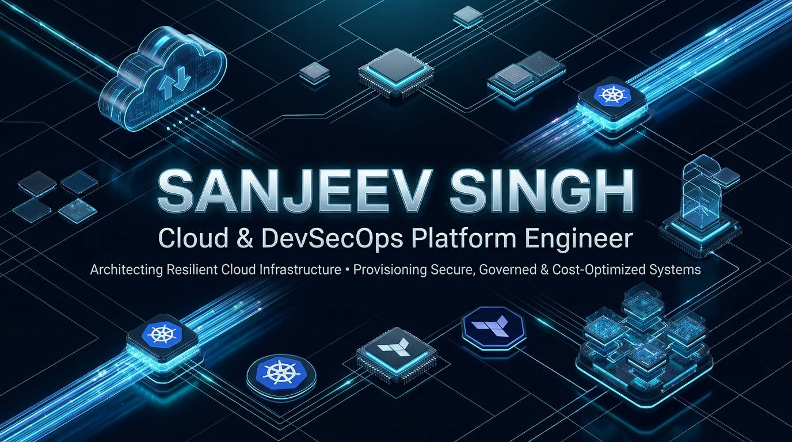
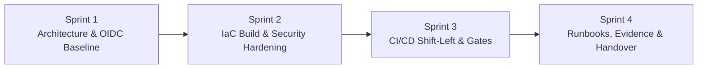

  

<h1 align="center">Sanjeev Singh</h1>

<b>Senior Azure Cloud Architect &amp; DevSecOps Platform Engineer | Enterprise Infrastructure Consultant</b>

  
  
  
  
  

---

## 📋 Executive Summary

Senior Azure Cloud Architect and DevSecOps Platform Engineer specializing in enterprise Terraform landing zones, Kubernetes (AKS) security, and automated CI/CD pipelines. With **10+ years of institutional IT and risk governance heritage** (State Bank of India) and **5+ years dedicated to Microsoft Azure architecture**, I design and deliver Zero-Trust cloud platforms with zero-plaintext credential exposure via passwordless GitHub Actions OIDC federation and static policy guardrails. My background includes architecting production cloud platforms for high-throughput electronic trading environments, regulatory compliance baselines (CIS Azure Benchmark v2.0 & NIST SP 800-53), and multi-region operational reliability. I partner directly with engineering leadership through structured, fixed-price delivery sprints.

> **Engineering Deep-Dive**: Review the sanitized case study on migrating high-throughput financial infrastructure to Azure: [Case Study: Enterprise Cloud Migration & Trading Platform Infrastructure](case-studies/trading-platform.md).

---

## 🛠️ Consulting Services & Outcomes

| Service Engagement | Technical Scope | Deliverable Outcome |
| :--- | :--- | :--- |
| **Azure Enterprise Landing Zones** | CAF Hub-and-Spoke mesh, Azure Firewall Standard, Azure Bastion, private DNS zones, and automated UDR route table inspection. | Deterministic, multi-region network isolation with automated spoke-to-spoke traffic inspection. |
| **Enterprise AI Landing Zones** | Secure Azure OpenAI deployments (GPT-4o), APIM AI Gateway token rate-limiting, Customer-Managed Keys (CMK), and Private Link. | Resilient, compliant AI inference platform shielded from public exposure and API quota exhaustion. |
| **AKS & DevSecOps Pipelines** | Hardened private Kubernetes clusters, Calico NetworkPolicy, Azure Key Vault CSI secret rotation, and passwordless OIDC pipelines. | Zero-trust container runtime with automated Gitleaks secret detection, Checkov/Trivy gates, and deployment approvals. |
| **FinOps & Policy Governance** | Custom Azure Policy initiatives, Management Group hierarchy, subscription vending, and Infracost CI cost gates. | Automated guardrails preventing runaway cloud expenditure and enforcing mandatory tagging. |
| **Disaster Recovery & Reliability** | Sanitized runbooks as code (AKS Velero restore, Key Vault recovery, Storage failover), Log Analytics baseline, and KQL query packs. | Deterministic disaster recovery procedures with tested sandbox drill logs and centralized telemetry. |
| **Enterprise IaC Module Libraries** | 11+ decoupled, reusable Terraform child modules with pinned provider constraints and pre-commit automation. | Production-tested IaC building blocks eliminating repetitive configuration boilerplate across teams. |

---

## 🚀 Featured Engineering Repositories

Each featured repository includes full Terraform source code, automated CI linting and security scanning, architectural decision records ([ARCHITECTURE.md](https://github.com/sanjiivsingh/azure-enterprise-landing-zone-terraform/blob/main/docs/ARCHITECTURE.md)), and transparent verification logs ([docs/EVIDENCE.md](https://github.com/sanjiivsingh/azure-enterprise-landing-zone-terraform/blob/main/docs/EVIDENCE.md)).

### 1. [Azure Enterprise AI Landing Zone](https://github.com/sanjiivsingh/azure-enterprise-ai-landing-zone-terraform)

- **Scope**: Enterprise-grade Azure OpenAI reference architecture.
- **Key Features**: API Management token-based rate limiting, private endpoints for Cognitive Services, Customer-Managed Key (CMK) encryption via Azure Key Vault, and concrete [COMPLIANCE.md](https://github.com/sanjiivsingh/azure-enterprise-ai-landing-zone-terraform/blob/main/COMPLIANCE.md) mapping to CIS Azure Benchmark v2.0.

### 2. [Azure Enterprise Landing Zone](https://github.com/sanjiivsingh/azure-enterprise-landing-zone-terraform)

- **Scope**: Microsoft Cloud Adoption Framework (CAF) Hub-and-Spoke topology.
- **Key Features**: Central Azure Firewall Standard with multi-spoke routing, Bastion host, private DNS zones, and zero-secret GitHub Actions OIDC deployment workflow.

### 3. [Azure AKS DevSecOps Pipeline](https://github.com/sanjiivsingh/azure-aks-devsecops-pipeline)

- **Scope**: Production-hardened AKS infrastructure with automated shift-left security.
- **Key Features**: Calico network policy enforcement, Azure Key Vault CSI driver secret rotation, automated Gitleaks secret detection, and staged deployment approval gates.

### 4. [Terraform Azure Resource Modules](https://github.com/sanjiivsingh/terraform-azure-resource-modules)

- **Scope**: Library of 11 standalone, verified Terraform child modules.
- **Key Features**: Decoupled modules for Virtual Network, Subnets, NSG, Azure Firewall, AKS, Key Vault, Storage Account, Cosmos DB, ACR, and Application Gateway.

### 5. [Azure Terraform Bootstrap & OIDC](https://github.com/sanjiivsingh/azure-terraform-bootstrap-oidc)

- **Scope**: Automated Day-0 foundation for Azure Terraform state and CI/CD security.
- **Key Features**: Provisions secure Azure Storage Account with state locking, disables storage key access, and configures Azure AD Application with GitHub federated OIDC credentials.

### 6. [Azure Landing Zone Governance](https://github.com/sanjiivsingh/azure-landing-zone-governance)

- **Scope**: Azure Policy as Code and subscription governance.
- **Key Features**: Custom policy initiatives enforcing location guardrails, mandatory FinOps tagging (`CostCenter`, `Owner`), TLS 1.2+ storage restrictions, and subscription vending.

> **Platform Baselines**: Also explore [`azure-observability-baseline`](https://github.com/sanjiivsingh/azure-observability-baseline) (Log Analytics & KQL packs), [`azure-finops-guardrails`](https://github.com/sanjiivsingh/azure-finops-guardrails) (Budgets & Infracost CI), and [`azure-dr-runbooks`](https://github.com/sanjiivsingh/azure-dr-runbooks) (Tested disaster recovery procedures).

---

## 🧩 Technical Competencies

| Domain | Validated Technologies & Tools |
| :--- | :--- |
| **Cloud Platform** | Microsoft Azure (CAF Landing Zones, Virtual WAN, ExpressRoute, Private Link, Azure Firewall, Azure Monitor, Log Analytics) |
| **Infrastructure as Code** | Terraform (`>= 1.5.0`), OpenTofu, ARM Templates, Bicep, Infracost, Terratest |
| **Containers & Orchestration** | Kubernetes, Azure Kubernetes Service (AKS), Docker, Helm, Calico Network Policies, Keda |
| **DevSecOps & Identity** | GitHub Actions, Passwordless OIDC Federation, Azure Workload Identity, Gitleaks, Checkov, Trivy, Azure Key Vault CMK |
| **FinOps & Governance** | Azure Policy as Code, Management Groups, Azure Consumption Budgets, Tag Enforcement, KQL Query Packs |
| **Automation & Tooling** | Bash, Python, Pre-commit, Dependabot, Git, Linux (Ubuntu/Debian) |

---

## 🔄 Delivery Model: Fixed-Price Sprints

Engagements are delivered in deterministic 1-to-2 week sprints with clear verification milestones:

1. **Sprint 1: Architecture Review & Security Baseline**: Assess requirements, agree on CAF topology (hub-and-spoke vs vWAN), configure remote state backend, and provision passwordless GitHub OIDC.
2. **Sprint 2: Modular IaC & Policy Guardrails**: Develop modular Terraform configurations, pre-commit validation hooks, and custom Azure Policy enforcement initiatives.
3. **Sprint 3: CI/CD Pipeline & Shift-Left Gates**: Build GitHub Actions workflows incorporating Gitleaks secret detection, Checkov static analysis, and automated environment promotion approvals.
4. **Sprint 4: Verification Evidence & Operations Handover**: Deliver `EVIDENCE.md` test audits, disaster recovery runbooks, Infracost estimates, and an architectural walkthrough with engineering teams.

---

## 📬 Discuss a Project / Contact

I am available for freelance consulting, cloud architecture design, and DevSecOps advisory contracts.

- **Portfolio & Client Inquiries**: [sanjeevsingh.oneps.in](https://sanjeevsingh.oneps.in)
- **Direct Engagement Inquiry**: [Submit Project Inquiry](https://sanjeevsingh.oneps.in/#contact)
- **GitHub**: [@sanjiivsingh](https://github.com/sanjiivsingh)
- **Case Study**: [High-Throughput Trading Platform Infrastructure](case-studies/trading-platform.md)
