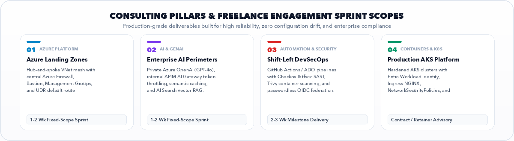
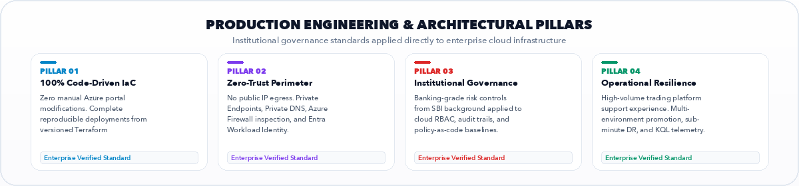
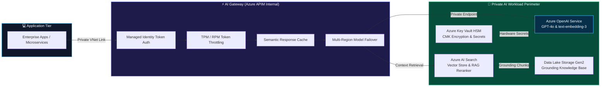
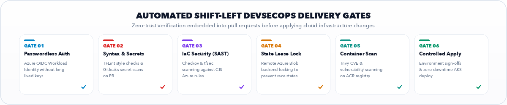
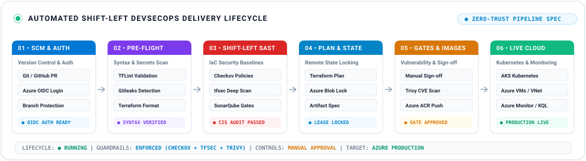
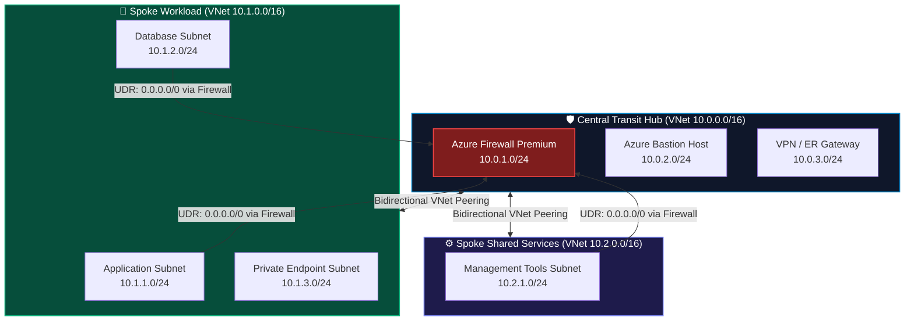
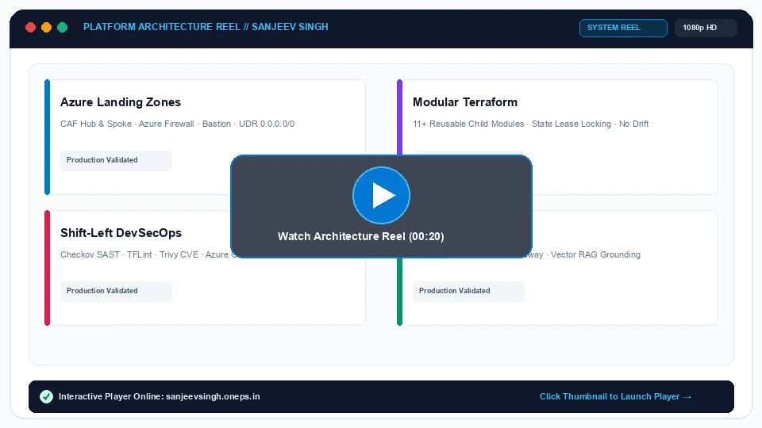
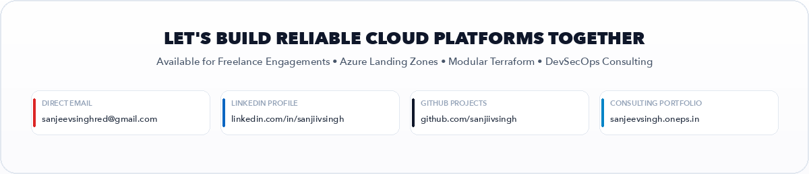

<div align="center">

<!-- Hero Banner (Spotless Light Foundation · Editorial Architecture · Zero Dots) -->
<a href="https://sanjeevsingh.oneps.in" target="_blank" rel="noopener noreferrer">
  
</a>

<br><br>

<!-- Minimalist Call-to-Action Bar (Clutter-Free, Direct Business Inquiries) -->
<p align="center">
  <a href="https://sanjeevsingh.oneps.in" target="_blank" rel="noopener noreferrer">
    
  </a>
  &nbsp;
  <a href="https://linkedin.com/in/sanjiivsingh" target="_blank" rel="noopener noreferrer">
    
  </a>
  &nbsp;
  <a href="https://github.com/sanjiivsingh?tab=repositories" target="_blank" rel="noopener noreferrer">
    
  </a>
  &nbsp;
  <a href="mailto:sanjeevsinghred@gmail.com">
    
  </a>
</p>

<!-- Subtitle / Business Focus -->
<p align="center">
  <b>Azure Landing Zones (CAF)</b> • <b>Production Terraform IaC</b> • <b>Shift-Left DevSecOps</b> • <b>Banking Governance Heritage (SBI)</b>
</p>

</div>

---

## 🏛️ Executive Summary & Freelance Positioning

I am an independent **Freelance Azure Cloud Engineer** and **Cloud Infrastructure Consultant** with **10+ years of professional engineering and institutional governance experience**, including **5+ years dedicated to architecting Microsoft Azure platforms, modular Terraform IaC, containerized Kubernetes (AKS) workloads, and automated DevSecOps pipelines**.

I partner with growing businesses, seed-to-scale startups, fintech platforms, and engineering leaders to solve infrastructure reliability, cloud security, and deployment automation bottlenecks:

* **Eliminating Configuration Drift:** Replacing manual Azure portal modifications with 100% code-driven, modular Terraform configurations backed by remote state lease locking and multi-environment isolation (Dev, UAT, Production).
* **Enterprise Cloud Foundations (CAF):** Implementing compliant, multi-subscription Azure Landing Zones with hierarchical Management Groups, central transit Hub-and-Spoke firewalls, and User-Defined Routes (UDR) for forced inspection.
* **Enterprise AI & GenAI Landing Zones:** Designing Zero-Trust foundations for Generative AI workloads—integrating **Azure OpenAI (GPT-4o)** via private endpoints, API Management as an **AI Gateway** (token rate-limiting, semantic caching), and **Azure AI Search** for vector RAG grounding.
* **High-Throughput Operational Experience:** Automated and supported Azure infrastructure for a high-volume US-based futures proprietary trading platform serving thousands of concurrent users, focusing on low-drift IaC and rapid disaster recovery.
* **Institutional Governance Heritage:** 4+ years as **Assistant Manager – Banking Operations / Risk & Compliance at State Bank of India (SBI)**. This tenure instilled an authentic foundation in operational risk controls, least-privilege RBAC, and audit readiness that I translate directly into Zero-Trust cloud defense.

---

## 🎯 Primary Calls to Action

| Destination | Purpose | Direct Link |
| :--- | :--- | :---: |
| **Consulting Portfolio** | Interactive case studies, architecture walkthroughs, and live video demos | [**sanjeevsingh.oneps.in →**](https://sanjeevsingh.oneps.in) |
| **Featured Projects** | Production-ready Terraform Landing Zones and DevSecOps pipelines | [**Inspect Repositories →**](#-featured-engineering-projects) |
| **Architecture Guides** | In-depth technical articles on module design and dependency patterns | [**Read Technical Docs →**](#-technical-articles--architecture-guides) |
| **Professional Network** | Connect for industry insights, collaboration, and client references | [**LinkedIn Profile →**](https://linkedin.com/in/sanjiivsingh) |
| **Project Inquiries** | Discuss freelance, contract, or architecture consulting engagements | [**Direct Email →**](mailto:sanjeevsinghred@gmail.com) |

---

## 💼 Freelance Services & Engagement Models

<p align="center">
  
</p>

I provide fixed-price sprint engagements, milestone deliverables, and advisory retainers with predictable outcomes and zero scope ambiguity:

| Service Sprint | Client Problem Solved | Core Deliverables | Typical Timeline |
| :--- | :--- | :--- | :---: |
| **Azure Landing Zone Foundation (CAF)** | Fragmented subscriptions, uninspected traffic, and manual network provisioning. | • Management Group hierarchy & subscription placement<br>• Central Azure Firewall, Bastion, & GatewaySubnet<br>• Bidirectional VNet peering with UDR default route inspection<br>• Azure Policy compliance initiatives & region guardrails | **1 – 2 Weeks**<br>(Fixed-Price Sprint) |
| **Enterprise AI & GenAI Private Perimeter** | Exposing proprietary data to public LLM endpoints without token governance or rate limits. | • Private Azure OpenAI (GPT-4o & text-embedding-3)<br>• Internal APIM AI Gateway (TPM/RPM token rate limiting)<br>• Semantic caching to reduce recurring inference costs<br>• Azure AI Search vector database for enterprise RAG | **1 – 2 Weeks**<br>(Fixed-Price Sprint) |
| **Shift-Left DevSecOps & Security Automation** | Vulnerabilities and hardcoded credentials reaching production environments uninspected. | • GitHub Actions / Azure DevOps CI/CD with OIDC auth<br>• Pre-commit linters (**TFLint**, **Gitleaks**) on every PR<br>• Automated IaC security scanning (**Checkov** & **tfsec**)<br>• Container image scanning (**Trivy**) & manual approval gates | **2 – 3 Weeks**<br>(Milestone Delivery) |
| **Production Kubernetes (AKS) Enablement** | Unhardened container clusters, node sprawl, and complex ingress configurations. | • Production AKS cluster provisioning via Terraform<br>• Microsoft Entra Workload Identity federation<br>• K8s NetworkSecurityPolicies & Ingress NGINX<br>• Horizontal Pod Autoscaler (HPA) & minimal distroless builds | **2 – 4 Weeks**<br>(Project / Milestone) |
| **Cloud Architecture & Security Posture Audit** | Ballooning cloud spend, configuration drift, and unverified compliance postures. | • Subscriptions & IAM security review against CIS Benchmarks<br>• FinOps cost-optimization and right-sizing report<br>• Prioritized refactoring backlog & architecture roadmap | **3 – 5 Days**<br>(Advisory Audit) |
| **Fractional Cloud Platform Engineering** | Need senior architectural leadership without the full-time overhead of an agency. | • Terraform module maintenance & peer review<br>• Platform upgrades, state drift remediation, & disaster recovery<br>• Mentoring engineering teams on cloud-native best practices | **Monthly Retainer**<br>(Ongoing Advisory) |

---

## 🛡️ Production Standards & Engineering Pillars

<p align="center">
  
</p>

Every infrastructure component I deliver adheres to four non-negotiable operational principles:

1. **100% Code-Driven Infrastructure:** Zero manual clicks in the Azure Portal. Every resource group, virtual network, security rule, and diagnostic setting is defined in versioned, peer-reviewed Terraform code.
2. **Zero-Trust Network Perimeter:** No PaaS service is exposed to the public internet. Connectivity is mediated through Private Endpoints, centralized Private DNS zones, and Azure Firewall inspection.
3. **Institutional Governance & Compliance:** Translating 4+ years of State Bank of India risk-management heritage into cloud engineering: least-privilege RBAC, automated audit trails, customer-managed encryption keys (CMK), and separation of duties.
4. **Operational Resilience & Low Drift:** Hardened through supporting a high-throughput US futures trading platform. Remote state locking in Azure Blob Storage prevents concurrent deployment collisions and enables sub-minute disaster recovery.

---

## 🌟 Featured Engineering Projects

A curated selection of production-grade reference architectures, modular IaC frameworks, and automation tooling:

<table>
<tr>
<td width="50%" valign="top">

### 🤖 [Azure Enterprise AI Landing Zone](https://github.com/sanjiivsingh/azure-enterprise-ai-landing-zone-terraform)
**Production Generative AI & LLM Infrastructure with Terraform**
- **Problem Solved:** Enterprise AI adoption requires strict data boundary governance, token rate limiting, and zero public internet exposure.
- **Engineering Approach:** Zero-Trust architecture provisioning **Azure OpenAI (GPT-4o & text-embedding-3)** mediated through **Azure API Management (APIM)** acting as an AI Gateway with token rate throttling (TPM/RPM), semantic caching, and vector grounding over **Azure AI Search**.
- **Verification Evidence:** Passed Checkov SAST, tfsec, and TFLint validations with `public_network_access_enabled = false` and private DNS zone links.
- **Stack:** Azure OpenAI · APIM AI Gateway · AI Search Vector RAG · Key Vault · Terraform · OIDC

👉 [**Inspect AI Landing Zone Repository →**](https://github.com/sanjiivsingh/azure-enterprise-ai-landing-zone-terraform)

</td>
<td width="50%" valign="top">

### 🏛️ [Azure Enterprise Hub-and-Spoke Landing Zone](https://github.com/sanjiivsingh/azure-enterprise-landing-zone-terraform)
**Enterprise Cloud Adoption Framework (CAF) Network Mesh**
- **Problem Solved:** Growing organizations need centralized traffic inspection, perimeter protection, and consistent routing between spoke workloads.
- **Engineering Approach:** Modular Terraform provisioning a central transit Hub with **Azure Firewall**, **Azure Bastion**, and hybrid VPN/ExpressRoute gateway. Automated bidirectional VNet peering connects spoke networks with custom **User-Defined Routes (UDRs)** forcing default `0.0.0.0/0` traffic inspection.
- **Verification Evidence:** Validated with TFLint, Checkov CIS Azure Benchmarks, and automated GitHub Actions plan workflows.
- **Stack:** Azure Firewall · Hub-and-Spoke · UDR Routing · Bastion · VNet Peering · Terraform

👉 [**Inspect Hub-and-Spoke Repository →**](https://github.com/sanjiivsingh/azure-enterprise-landing-zone-terraform)

</td>
</tr>

<tr>
<td width="50%" valign="top">

### 🏢 [Azure Platform Enterprise Landing Zone](https://github.com/sanjiivsingh/azure-landing-zone-enterprise)
**Multi-Tier Management Group Hierarchy & Governance Foundation**
- **Problem Solved:** Enterprise cloud environments require clear separation between platform services (connectivity, identity, management) and application workloads.
- **Engineering Approach:** Implements a multi-tier Management Group tree (`Platform`, `Landing Zones`, `Sandboxes`, `Decommissioned`) with automated subscription placement, custom RBAC assignments, and policy inheritance baselines.
- **Verification Evidence:** Released as tagged version `v1.0.0`, verified with automated Checkov policy scans and Terraform plan validation.
- **Stack:** Management Groups · Subscription Placement · RBAC · Azure Policy · Terraform

👉 [**Inspect Platform Landing Zone Repository →**](https://github.com/sanjiivsingh/azure-landing-zone-enterprise)

</td>
<td width="50%" valign="top">

### 🛡️ [Azure AKS DevSecOps Pipeline](https://github.com/sanjiivsingh/azure-aks-devsecops-pipeline)
**Production CI/CD: Terraform · SonarQube · Trivy · Docker · ACR · AKS**
- **Problem Solved:** Bridging the gap between software delivery and security controls to stop vulnerabilities from reaching production.
- **Engineering Approach:** End-to-end continuous delivery pipeline integrating pre-flight linters, static security analysis (**Checkov** & **tfsec**), container vulnerability scanning (**Trivy**), minimal distroless builds, and automated rolling deployments to **Azure Kubernetes Service (AKS)**.
- **Verification Evidence:** Integrated GitHub Actions workflow enforcing strict quality gates and manual sign-offs before production promotion.
- **Stack:** Azure AKS · Docker · ACR · Trivy · Checkov · SonarQube · Terraform · GitHub Actions

👉 [**Inspect DevSecOps Pipeline Repository →**](https://github.com/sanjiivsingh/azure-aks-devsecops-pipeline)

</td>
</tr>

<tr>
<td width="50%" valign="top">

### 📦 [Terraform Azure Reusable Resource Modules](https://github.com/sanjiivsingh/terraform-azure-resource-modules)
**Enterprise Multi-Tier Azure IaC Child-Module Library**
- **Problem Solved:** Code duplication, hardcoded configurations, and state collisions across multi-environment deployments.
- **Engineering Approach:** Engineered 11+ independent, enterprise-grade child modules (Resource Group, VNet, Subnet, NSG, Public IP, NIC, Linux VM, Bastion, Key Vault, and Application Gateway) architected for implicit dependency resolution and multi-environment decoupling.
- **Verification Evidence:** Automated GitHub Actions pipeline validating formatting (`terraform fmt`), syntax, and plan generation on every PR.
- **Stack:** Terraform 1.9+ · AzureRM Provider · Modular IaC · Key Vault · App Gateway · CI/CD

👉 [**Inspect Reusable Modules Repository →**](https://github.com/sanjiivsingh/terraform-azure-resource-modules)

</td>
<td width="50%" valign="top">

### ⚡ [PropEdge Trading Platform Infrastructure Lab](https://github.com/sanjiivsingh/propedge-docker-lab)
**High-Concurrency Multi-Tier Containerized Workload Deployment**
- **Problem Solved:** Deploying and operating a high-throughput financial trading application requiring private service networking and zero exposed public ports.
- **Engineering Approach:** Multi-container stack orchestrated via Docker Compose with segregated bridge networks separating the React frontend, FastAPI backend, and PostgreSQL database on hardened Azure Virtual Machines, fronted securely by Cloudflare Tunnel.
- **Verification Evidence:** Verified private network isolation, persistent database volume leasing, and automated container lifecycle scripts.
- **Stack:** Azure VMs · Docker Compose · FastAPI · PostgreSQL · React · Cloudflare Tunnel

👉 [**Inspect PropEdge Trading Lab →**](https://github.com/sanjiivsingh/propedge-docker-lab)

</td>
</tr>

<tr>
<td width="50%" valign="top">

### 🛠️ [CREP — Code Repository Environment Provisioner](https://github.com/sanjiivsingh/CREP)
**CLI Tool for Standardized Git & GitHub Lifecycle Automation**
- **Problem Solved:** Inconsistent repository bootstrapping, missing branch protection rules, and manual configuration overhead across teams.
- **Engineering Approach:** Developed a modular Bash command-line utility automating repository provisioning, visibility toggling, `.gitignore` templating, and remote Git synchronization via the GitHub CLI (`gh`).
- **Verification Evidence:** Built with modular sub-command architecture, comprehensive error trapping, and documented ADRs.
- **Stack:** Bash · GitHub CLI · Git · Linux Shell · Automation

👉 [**Inspect CREP Provisioner Repository →**](https://github.com/sanjiivsingh/CREP)

</td>
<td width="50%" valign="top">

### 🔒 [Azure Private Networking Landing Zone](https://github.com/sanjiivsingh/azure-landing-zone-private-networking)
**Zero-Trust PaaS Isolation & Automated Private DNS Resolution**
- **Problem Solved:** Eliminates data exfiltration risks and split-brain DNS issues when accessing PaaS resources over private backbones.
- **Engineering Approach:** Provisions Private Endpoints for storage and database resources, links centralized Private DNS Zones, and automates A-record registration with micro-segmented network security rules.
- **Verification Evidence:** Released as `v1.0.0`, verified with zero public IP allocations and automated Checkov compliance tests.
- **Stack:** Private Endpoints · Private Link · Private DNS · Zero-Trust · Terraform

👉 [**Inspect Private Networking Repository →**](https://github.com/sanjiivsingh/azure-landing-zone-private-networking)

</td>
</tr>
</table>

---

## 📐 Architecture & Engineering Visuals

### 1. Enterprise AI & GenAI Landing Zone Architecture

A production Zero-Trust blueprint for private Generative AI workloads with API Management AI Gateway governance and vector RAG grounding:



### 2. Automated Shift-Left DevSecOps Delivery Gates

<p align="center">
  
</p>

### 3. End-to-End DevSecOps Pipeline Flow Diagram

Security controls are embedded directly into every stage of the infrastructure and container delivery lifecycle:

<p align="center">
  
</p>

### 4. CAF Hub-and-Spoke Network Routing Topology

A standardized transit Hub network routing all spoke-to-spoke and spoke-to-internet traffic through Azure Firewall:



---

## 🧰 Core Technical Capabilities

A structured breakdown of technologies verified through production implementations and open-source codebases:

| Domain | Specialization & Verified Technologies |
| :--- | :--- |
| **Cloud Platforms** | **Microsoft Azure** (Enterprise Cloud Adoption Framework, Multi-Subscription Governance, Management Groups, Resource Hierarchies) |
| **Infrastructure as Code** | **Terraform (1.9+)**, OpenTofu, Reusable Child Modules, Azure Blob Remote State with Lease Locking, Dynamic Blocks, Locals, Strict Input Validation |
| **CI/CD & Automation** | **GitHub Actions**, **Azure DevOps Pipelines**, Passwordless Azure OIDC Workload Identity Federation, Automated Plan/Apply, Deployment Approval Gates |
| **DevSecOps & SAST** | **Checkov**, **tfsec**, **TFLint**, **Trivy** (Container Scanning), **Gitleaks**, **SonarQube**, Azure Key Vault HSM & CMK, CIS Azure Benchmarks |
| **Containers & Kubernetes** | **Docker**, **Docker Compose**, **Azure Kubernetes Service (AKS)**, Azure Container Registry (ACR), Helm, Workload Identity, K8s NetworkPolicies |
| **Cloud Networking & Security** | Hub-and-Spoke VNets, **Azure Firewall**, **Azure Bastion**, User-Defined Routes (UDR), **Private Endpoints**, **Private DNS Zones**, NSG Micro-segmentation |
| **Observability & Operations** | **Azure Monitor**, **Log Analytics Workspaces**, Application Insights, KQL (Kusto Query Language), Alerts & Action Groups, FinOps Cost Governance |
| **Scripting & Tooling** | Linux Administration, **Bash Shell Scripting**, **Python**, YAML, Git, GitHub CLI (`gh`) |

---

## 📖 Technical Articles & Architecture Guides

Deep-dive architectural documentation written from practical infrastructure engineering lessons:

* 📄 **[Storage Account Implicit Dependency Architecture](https://github.com/sanjiivsingh/terraform-azure-foundation/blob/main/docs/architecture/storage-account-implicit-dependency.md)**  
  *Eliminating manual `depends_on` anti-patterns in Terraform by designing clean output-to-input local value transformation pipelines for automated graph sequencing.*
* 📄 **[Reusable Terraform Child-Module Design Standards](https://github.com/sanjiivsingh/terraform-azure-foundation/blob/main/docs/architecture/module-design-principles.md)**  
  *Enterprise standards for input maps, optional attribute schemas, standardized output maps, and predictable resource naming.*
* 📄 **[Architecture Decision Record: CI & Main Branch Governance (ADR-001)](https://github.com/sanjiivsingh/CREP/blob/main/docs/adr/ADR-001-ci-and-main-branch-governance.md)**  
  *Designing automated pull request validation gates, branch protection baselines, and semantic release tagging.*
* 📄 **[Zero-Trust Private Endpoints & DNS Resolution Guide](https://github.com/sanjiivsingh/azure-landing-zone-private-networking/blob/main/docs/architecture.md)**  
  *Establishing private PaaS perimeters and preventing split-brain DNS resolution across multi-spoke Azure networks.*
* 📄 **[Shift-Left DevSecOps: Policy-as-Code with Checkov & Trivy](https://github.com/sanjiivsingh/azure-aks-devsecops-pipeline#readme)**  
  *Implementing automated security checks directly inside CI/CD workflows to catch vulnerabilities before infrastructure provisioning.*

---

## 🎬 Platform Architecture Reel & Interactive Walkthrough

A visual walkthrough demonstrating enterprise Azure architecture patterns, container delivery, and security scanning:

<div align="center">

<p align="center">
  <a href="https://sanjeevsingh.oneps.in" target="_blank" rel="noopener noreferrer">
    
  </a>
</p>

<p align="center">
  <a href="https://sanjeevsingh.oneps.in" target="_blank" rel="noopener noreferrer">
    
  </a>
  &nbsp;
  <a href="./assets/intro.mp4" target="_blank">
    
  </a>
  &nbsp;
  <a href="https://github.com/sanjiivsingh" target="_blank" rel="noopener noreferrer">
    
  </a>
</p>

</div>

---

## 💼 Career History & Institutional Governance Heritage

```text
├── FREELANCE / CONTRACT CLOUD & DEVSECOPS ENGINEER (2021 – Present)
│   ├── Multiple Enterprise Client Engagements | Gurugram, India
│   └── High-Throughput US Futures Proprietary Trading Platform
│       ├── Supported Azure infrastructure automation & DevOps for a high-volume platform
│       ├── Engineered modular Terraform modules for networking, compute, Key Vault, and AKS
│       ├── Implemented DevSecOps pipelines with Checkov, tfsec, TFLint, Trivy, and Gitleaks
│       └── Centralized Terraform remote state backend in Azure Storage with automated locking
│
└── STATE BANK OF INDIA (2012 – 2016)
    └── Assistant Manager – Banking Operations / Risk & Compliance
        ├── Managed banking operations involving operational risk controls, audit & regulatory compliance
        ├── Supervised dual-control access authorization processes for high-value financial transactions
        └── Established the institutional risk-management and zero-trust mindset applied to Cloud Security today
```

### 🎓 Education & Professional Recognition
* **Google AI Essentials** — Google (2025)
* **DevSecOps Initiative Award** — Engineering Recognition (2023)
* **JAIIB** — Indian Institute of Banking & Finance (2014)
* **Spotlight Award (Operational Excellence)** — State Bank of India (2015)
* **Bachelor of Computer Applications (BCA)** — Indira Gandhi National Open University (IGNOU, 2009)

---

## 🤝 Let's Collaborate

Whether you need to architect **Enterprise Azure Landing Zones**, adopt **Modular Terraform Infrastructure as Code**, harden **Kubernetes (AKS)** workloads, or establish **Shift-Left DevSecOps Pipelines**, I am available for high-impact freelance consulting and client engagements.

<div align="center">

<p align="center">
  <a href="mailto:sanjeevsinghred@gmail.com">
    
  </a>
</p>

<p align="center">
  <a href="mailto:sanjeevsinghred@gmail.com">
    
  </a>
  &nbsp;
  <a href="https://linkedin.com/in/sanjiivsingh" target="_blank" rel="noopener noreferrer">
    
  </a>
  &nbsp;
  <a href="https://github.com/sanjiivsingh" target="_blank" rel="noopener noreferrer">
    
  </a>
  &nbsp;
  <a href="https://sanjeevsingh.oneps.in" target="_blank" rel="noopener noreferrer">
    
  </a>
</p>

</div>
