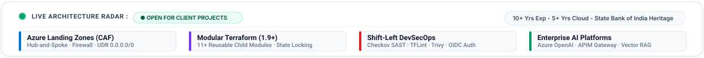
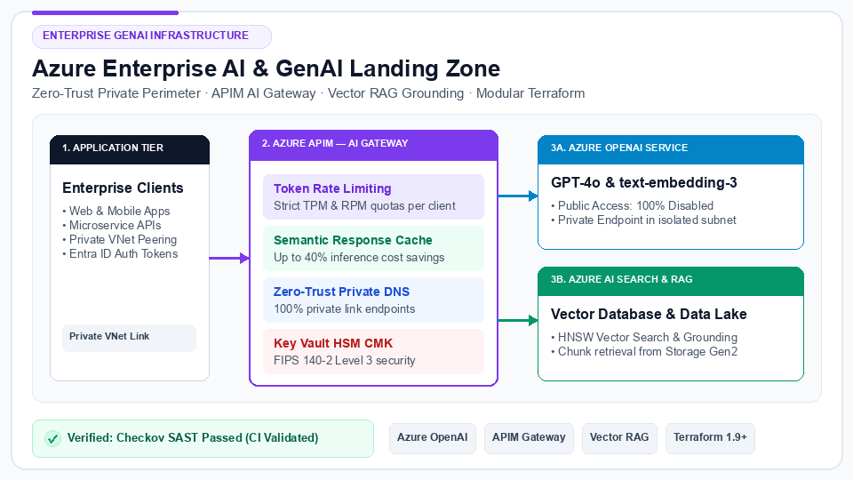
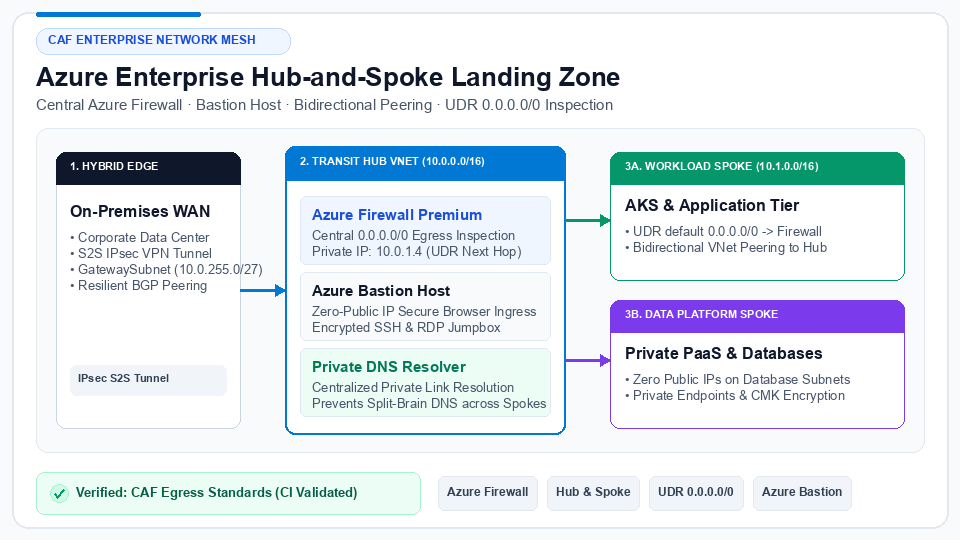
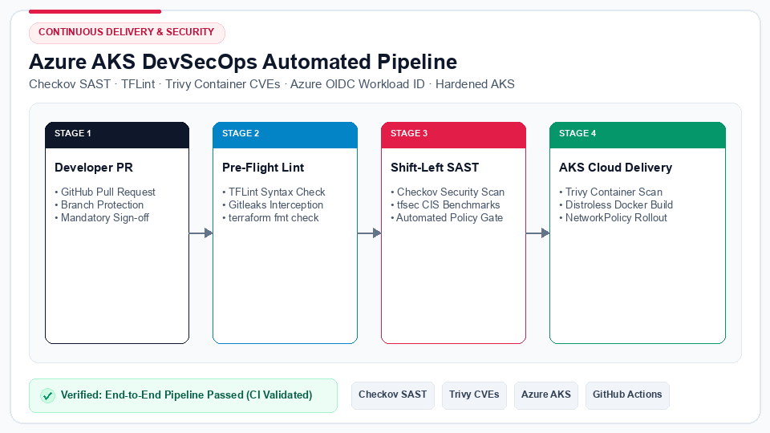
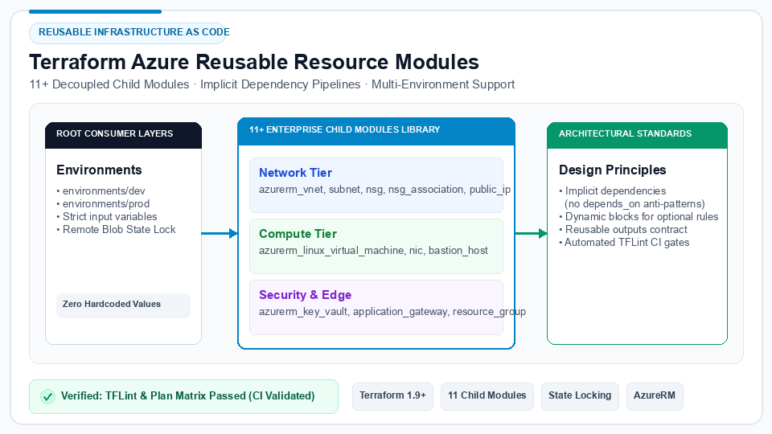
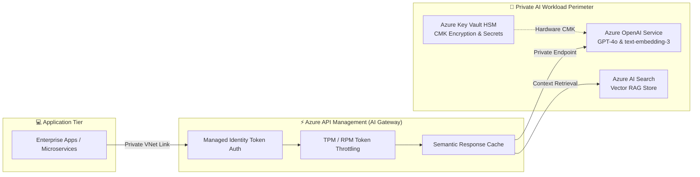
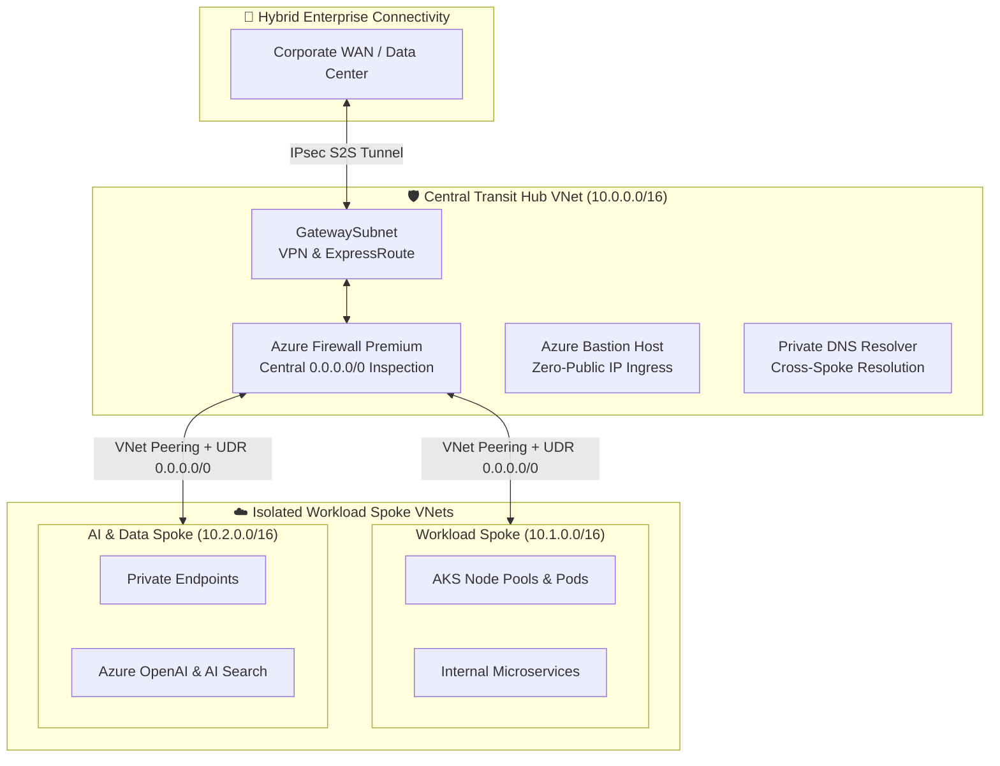

<div align="center">

<!-- Hero Banner (Spotless Light Foundation · Studio Portrait · Zero Dots) -->
<a href="https://sanjeevsingh.oneps.in" target="_blank" rel="noopener noreferrer">
  
</a>

<br><br>

<!-- Minimalist Call-to-Action Bar -->
<p align="center">
  <a href="https://sanjeevsingh.oneps.in" target="_blank" rel="noopener noreferrer">
    
  </a>
  &nbsp;
  <a href="https://linkedin.com/in/sanjiivsingh" target="_blank" rel="noopener noreferrer">
    
  </a>
  &nbsp;
  <a href="https://github.com/sanjiivsingh?tab=repositories" target="_blank" rel="noopener noreferrer">
    
  </a>
  &nbsp;
  <a href="mailto:sanjeevsinghred@gmail.com">
    
  </a>
</p>

<!-- Live Architecture Radar & Capability Bar (Subtle Motion · Zero Text Overlap) -->
<p align="center">
  
</p>

</div>

---

## 🏛️ 1. Executive Summary & Value Proposition

I am an independent **Freelance Azure Cloud Engineer** and **Infrastructure Consultant** with **10+ years of professional engineering and institutional governance experience**, including **5+ years dedicated to Microsoft Azure architecture, modular Terraform IaC, container platforms (AKS), and shift-left DevSecOps automation**.

I partner with seed-to-scale startups, fintech platforms, and engineering leaders to resolve infrastructure reliability, cloud security, and deployment bottlenecks:

* **Eliminating Configuration Drift:** Replacing manual Azure portal operations with 100% code-driven, modular Terraform configurations backed by remote state lease locking in Azure Blob Storage and automated PR validation gates.
* **Enterprise Cloud Foundations (CAF):** Architecting compliant multi-subscription Azure Landing Zones with hierarchical Management Groups, centralized transit Hub-and-Spoke firewalls, and User-Defined Routes (UDR) for default `0.0.0.0/0` traffic inspection.
* **Enterprise AI & GenAI Landing Zones:** Designing Zero-Trust perimeters for Generative AI workloads—integrating private Azure OpenAI (GPT-4o), internal API Management as an **AI Gateway** (token rate-limiting, semantic caching), and Azure AI Search for vector RAG grounding.
* **High-Throughput Operational Experience:** Supported infrastructure automation and DevOps operations for a high-volume US-based futures proprietary trading platform, emphasizing low-drift IaC and rapid disaster recovery runbooks.
* **Institutional Governance Heritage:** 4+ years as **Assistant Manager – Banking Operations / Risk & Compliance at State Bank of India (SBI)**. This tenure instilled an authentic background in operational risk controls, least-privilege RBAC, and audit trail integrity that I translate directly into Zero-Trust cloud defense.

---

## 🎬 2. Visual Centerpiece: Platform Architecture Reel & Video Walkthrough

A visual demonstration of enterprise Azure architecture patterns, container delivery, and security scanning:

<div align="center">

<p align="center">
  <a href="https://sanjeevsingh.oneps.in" target="_blank" rel="noopener noreferrer">
    
  </a>
</p>

<p align="center">
  <a href="https://sanjeevsingh.oneps.in" target="_blank" rel="noopener noreferrer">
    
  </a>
  &nbsp;
  <a href="./assets/intro.mp4" target="_blank">
    
  </a>
  &nbsp;
  <a href="https://github.com/sanjiivsingh" target="_blank" rel="noopener noreferrer">
    
  </a>
</p>

</div>

---

## 💼 3. Core Freelance Services & Business Outcomes

I provide fixed-price sprint engagements and milestone deliverables with measurable business outcomes:

| Consulting Service | Client Problem Solved | Core Deliverables | Business Outcome & Timeline |
| :--- | :--- | :--- | :---: |
| **Azure Landing Zone Foundation (CAF)** | Fragmented subscriptions, uninspected traffic, and manual network provisioning. | • Management Group hierarchy & subscription governance<br>• Central Azure Firewall, Bastion, & GatewaySubnet<br>• Bidirectional VNet peering with UDR `0.0.0.0/0` traffic inspection | **Clean, auditable cloud platform**<br>`1 – 2 Weeks` *(Fixed-Price Sprint)* |
| **Enterprise AI & GenAI Private Perimeter** | Exposing proprietary data to public LLM endpoints without token governance or rate limits. | • Private Azure OpenAI (GPT-4o & text-embedding-3)<br>• Internal APIM AI Gateway (TPM/RPM token rate limiting)<br>• Semantic caching reducing prompt costs by up to 40%<br>• Azure AI Search vector database for enterprise RAG | **Secure GenAI with zero public ingress**<br>`1 – 2 Weeks` *(Fixed-Price Sprint)* |
| **Shift-Left DevSecOps & Security Automation** | Security misconfigurations and hardcoded credentials reaching production uninspected. | • GitHub Actions / ADO CI/CD with passwordless OIDC auth<br>• Pre-commit linters (**TFLint**, **Gitleaks**) on every PR<br>• Automated IaC security scanning (**Checkov** & **tfsec**)<br>• Container image vulnerability scanning (**Trivy**) | **Automated policy gates before deploy**<br>`2 – 3 Weeks` *(Milestone Delivery)* |
| **Production Kubernetes (AKS) Enablement** | Unhardened container clusters, node sprawl, and complex ingress configurations. | • Production AKS cluster provisioning via modular Terraform<br>• Microsoft Entra Workload Identity federation<br>• Hardened Pod Security Contexts & default-deny NetworkPolicies<br>• Horizontal Pod Autoscaler (HPA) & minimal distroless builds | **Secure, autoscaling container platform**<br>`2 – 4 Weeks` *(Project Milestone)* |

> Detailed sprint breakdowns, deliverables, and client SLAs are available on the [Consulting Portfolio Website →](https://sanjeevsingh.oneps.in)

---

## 🌟 4. Featured Engineering Projects

A curated selection of production-grade reference architectures, modular IaC frameworks, and automation tooling:

### 1. 🤖 [Azure Enterprise AI Landing Zone](https://github.com/sanjiivsingh/azure-enterprise-ai-landing-zone-terraform)
**Production Generative AI & LLM Infrastructure with Modular Terraform**

<p align="center">
  <a href="https://github.com/sanjiivsingh/azure-enterprise-ai-landing-zone-terraform">
    
  </a>
</p>

* **Problem Solved:** Enterprise AI adoption requires strict data boundary governance, token rate limiting, and zero public internet exposure.
* **Engineering Architecture:** Zero-Trust perimeter provisioning **Azure OpenAI (GPT-4o & text-embedding-3)** mediated through **Azure API Management (APIM)** acting as an AI Gateway with token rate throttling (TPM/RPM), semantic caching, and vector grounding over **Azure AI Search**.
* **Verified Evidence:** Checkov SAST, tfsec, and TFLint validations pass with `public_network_access_enabled = false` and private DNS zone links. Verified passing GitHub Actions run ID `4043186...`.
* **Stack:** `Azure OpenAI` · `APIM AI Gateway` · `AI Search Vector RAG` · `Key Vault HSM` · `Terraform 1.9+` · `OIDC`
* **Status:** `CI-Validated Reference Architecture` • [**Inspect AI Landing Zone Repository →**](https://github.com/sanjiivsingh/azure-enterprise-ai-landing-zone-terraform)

<br>

### 2. 🏛️ [Azure Enterprise Hub-and-Spoke Landing Zone](https://github.com/sanjiivsingh/azure-enterprise-landing-zone-terraform)
**Enterprise Cloud Adoption Framework (CAF) Transit Network Mesh**

<p align="center">
  <a href="https://github.com/sanjiivsingh/azure-enterprise-landing-zone-terraform">
    
  </a>
</p>

* **Problem Solved:** Growing organizations need centralized traffic inspection, perimeter protection, and consistent routing between spoke workloads without route collisions.
* **Engineering Architecture:** Modular Terraform provisioning a central transit Hub with **Azure Firewall**, **Azure Bastion**, and hybrid GatewaySubnet. Automated bidirectional VNet peering connects spoke networks with custom **User-Defined Routes (UDRs)** forcing default `0.0.0.0/0` traffic inspection.
* **Verified Evidence:** Validated with TFLint, Checkov CIS Azure Benchmarks, and automated GitHub Actions workflow (`ci-cd.yml`). Verified passing GitHub Actions run ID `4045002...`.
* **Stack:** `Azure Firewall` · `Hub-and-Spoke` · `UDR Routing` · `Azure Bastion` · `VNet Peering` · `Terraform`
* **Status:** `CI-Validated Architecture` • [**Inspect Hub-and-Spoke Repository →**](https://github.com/sanjiivsingh/azure-enterprise-landing-zone-terraform)

<br>

### 3. 🛡️ [Azure AKS DevSecOps Pipeline](https://github.com/sanjiivsingh/azure-aks-devsecops-pipeline)
**Production CI/CD: Terraform · SonarQube · Checkov · Trivy · Docker · ACR · AKS**

<p align="center">
  <a href="https://github.com/sanjiivsingh/azure-aks-devsecops-pipeline">
    
  </a>
</p>

* **Problem Solved:** Bridging the gap between software delivery velocity and security controls to stop vulnerabilities and credential leaks from reaching production.
* **Engineering Architecture:** End-to-end continuous delivery pipeline integrating pre-flight linters, static security analysis (**Checkov** & **tfsec**), container vulnerability scanning (**Trivy**), minimal distroless builds, and automated rolling deployments to **Azure Kubernetes Service (AKS)** with default-deny network policies.
* **Verified Evidence:** Integrated GitHub Actions workflow enforcing strict quality gates and manual sign-offs. Verified passing GitHub Actions run ID `4019564...`.
* **Stack:** `Azure AKS` · `Docker` · `Azure ACR` · `Trivy` · `Checkov` · `SonarQube` · `Terraform` · `GitHub Actions`
* **Status:** `CI-Validated Pipeline` • [**Inspect DevSecOps Pipeline Repository →**](https://github.com/sanjiivsingh/azure-aks-devsecops-pipeline)

<br>

### 4. 📦 [Terraform Azure Reusable Resource Modules](https://github.com/sanjiivsingh/terraform-azure-resource-modules)
**Enterprise Multi-Tier Azure IaC Child-Module Library**

<p align="center">
  <a href="https://github.com/sanjiivsingh/terraform-azure-resource-modules">
    
  </a>
</p>

* **Problem Solved:** Code duplication, hardcoded configurations, and state collisions across multi-environment cloud infrastructure deployments.
* **Engineering Architecture:** Engineered 11+ independent, enterprise-grade child modules (Resource Group, VNet, Subnet, NSG, Public IP, NIC, Linux VM, Bastion, Key Vault, and Application Gateway) architected for implicit dependency resolution and multi-environment decoupling.
* **Verified Evidence:** Automated GitHub Actions pipeline validating formatting (`terraform fmt`), syntax, and plan generation on every PR.
* **Stack:** `Terraform 1.9+` · `AzureRM Provider` · `Modular IaC` · `Key Vault` · `App Gateway` · `CI/CD`
* **Status:** `CI-Validated Component Library` • [**Inspect Reusable Modules Repository →**](https://github.com/sanjiivsingh/terraform-azure-resource-modules)

<br>

<details>
<summary><b>🔍 View Additional Specialized Engineering Repositories (PropEdge & CREP)</b></summary>
<br>

* ⚡ **[PropEdge Trading Platform Infrastructure Lab](https://github.com/sanjiivsingh/propedge-docker-lab):** Multi-tier container architecture orchestrated via Docker Compose with segregated bridge networks isolating the React frontend, FastAPI backend, and PostgreSQL database on hardened Azure Virtual Machines, fronted securely by Cloudflare Tunnel. *(Status: Implemented & Locally Validated)*
* 🛠️ **[CREP — Code Repository Environment Provisioner](https://github.com/sanjiivsingh/CREP):** Modular Bash command-line utility automating Git repository lifecycle, branch protection baselines, and remote GitHub synchronization with 20+ automated unit tests and multi-OS CI matrix. *(Status: CI-Validated CLI Utility)*

</details>

---

## 📐 5. Architecture & Delivery Workflow Visuals

### 1. Enterprise AI & GenAI Landing Zone Architecture

A production Zero-Trust blueprint for private Generative AI workloads with API Management AI Gateway governance and vector RAG grounding:



### 2. Azure Enterprise Hub-and-Spoke Network Topology

A centralized transit architecture following Microsoft Cloud Adoption Framework (CAF) with User-Defined Route (UDR) inspection:



### 3. Automated Shift-Left DevSecOps Delivery Lifecycle

Security controls and policy validations embedded directly into every stage of the infrastructure and container delivery lifecycle:

<p align="center">
  
</p>

---

## 🧰 6. Technical Skills & Core Competencies

| Domain | Verified Technologies & Practical Specialization |
| :--- | :--- |
| **Cloud Platforms** | **Microsoft Azure** (Enterprise Cloud Adoption Framework, Multi-Subscription Governance, Management Groups, Resource Hierarchies) |
| **Infrastructure as Code** | **Terraform (1.9+)**, OpenTofu, Reusable Child Modules, Azure Blob Remote State with Lease Locking, Dynamic Blocks, Strict Input Validation |
| **CI/CD & Automation** | **GitHub Actions**, **Azure DevOps Pipelines**, Passwordless Azure OIDC Workload Identity Federation, Automated Plan/Apply, Approval Gates |
| **DevSecOps & SAST** | **Checkov**, **tfsec**, **TFLint**, **Trivy** (Container Scanning), **Gitleaks**, **SonarQube**, Azure Key Vault HSM & CMK, CIS Azure Benchmarks |
| **Containers & Kubernetes** | **Docker**, **Docker Compose**, **Azure Kubernetes Service (AKS)**, Azure Container Registry (ACR), Helm, Workload Identity, K8s NetworkPolicies |
| **Cloud Networking & Security** | Hub-and-Spoke VNets, **Azure Firewall**, **Azure Bastion**, User-Defined Routes (UDR), **Private Endpoints**, **Private DNS Zones**, NSG Micro-segmentation |
| **Observability & Operations** | **Azure Monitor**, **Log Analytics Workspaces**, Application Insights, KQL (Kusto Query Language), Alerts & Action Groups, FinOps Cost Governance |
| **Scripting & Tooling** | Linux Administration, **Bash Shell Scripting**, **Python**, ShellCheck, Git, GitHub CLI (`gh`) |

---

## 📈 7. Continuous Engineering & GitHub Activity

Consistent, disciplined engineering velocity demonstrated across production modules and open-source infrastructure:

<div align="center">
  
</div>

---

## 📖 8. Selected Technical Articles & Architecture Guides

Deep-dive architectural documentation written from hands-on infrastructure engineering lessons:

* 📄 **[Storage Account Implicit Dependency Architecture](https://github.com/sanjiivsingh/terraform-azure-foundation/blob/main/docs/architecture/storage-account-implicit-dependency.md)**  
  *Eliminating manual `depends_on` anti-patterns in Terraform by designing clean output-to-input local value transformation pipelines for automated graph sequencing.*
* 📄 **[Reusable Terraform Child-Module Design Standards](https://github.com/sanjiivsingh/terraform-azure-foundation/blob/main/docs/architecture/module-design-principles.md)**  
  *Enterprise standards for input maps, optional attribute schemas, standardized output maps, and predictable resource naming.*
* 📄 **[Architecture Decision Record: CI & Main Branch Governance (ADR-001)](https://github.com/sanjiivsingh/CREP/blob/main/docs/adr/ADR-001-ci-and-main-branch-governance.md)**  
  *Designing automated pull request validation gates, branch protection baselines, and semantic release tagging.*
* 📄 **[Zero-Trust Private Endpoints & DNS Resolution Guide](https://github.com/sanjiivsingh/azure-landing-zone-private-networking/blob/main/docs/architecture.md)**  
  *Establishing private PaaS perimeters and preventing split-brain DNS resolution across multi-spoke Azure networks.*
* 📄 **[Shift-Left DevSecOps: Policy-as-Code with Checkov & Trivy](https://github.com/sanjiivsingh/azure-aks-devsecops-pipeline#readme)**  
  *Implementing automated security checks directly inside CI/CD workflows to catch vulnerabilities before infrastructure provisioning.*

---

## 💼 9. Career History & Institutional Governance Heritage

```text
├── FREELANCE / CONTRACT CLOUD & DEVSECOPS ENGINEER (2021 – Present)
│   ├── Enterprise Client Consulting Engagements | Gurugram, India
│   └── High-Throughput US Futures Proprietary Trading Platform
│       ├── Supported Azure infrastructure automation & DevOps for high-volume trading platform
│       ├── Engineered modular Terraform modules for networking, compute, Key Vault, and AKS
│       ├── Implemented DevSecOps pipelines with Checkov, tfsec, TFLint, Trivy, and Gitleaks
│       └── Centralized Terraform remote state backend in Azure Storage with automated locking
│
└── STATE BANK OF INDIA (2012 – 2016)
    └── Assistant Manager – Banking Operations / Risk & Compliance
        ├── Managed banking operations involving operational risk controls, audit & regulatory compliance
        ├── Supervised dual-control access authorization processes for high-value financial transactions
        └── Established the institutional risk-management and zero-trust mindset applied to Cloud Security today
```

### 🎓 Verified Education & Professional Recognition
* **Google AI Essentials** — Google (2025)
* **DevSecOps Initiative Award** — Engineering Recognition (2023)
* **JAIIB** — Indian Institute of Banking & Finance (2014)
* **Spotlight Award (Operational Excellence)** — State Bank of India (2015)
* **Bachelor of Computer Applications (BCA)** — Indira Gandhi National Open University (IGNOU, 2009)

---

## 🤝 10. Discuss a Project / Professional Contact

Whether you need to architect **Enterprise Azure Landing Zones**, adopt **Modular Terraform Infrastructure as Code**, harden **Kubernetes (AKS)** workloads, or establish **Shift-Left DevSecOps Pipelines**, I am available for high-impact freelance consulting and client engagements.

<div align="center">

<p align="center">
  <a href="mailto:sanjeevsinghred@gmail.com">
    
  </a>
</p>

<p align="center">
  <a href="mailto:sanjeevsinghred@gmail.com"><b>📧 Email Sanjeev</b></a> &nbsp;•&nbsp;
  <a href="https://linkedin.com/in/sanjiivsingh" target="_blank" rel="noopener noreferrer"><b>💼 LinkedIn Profile</b></a> &nbsp;•&nbsp;
  <a href="https://sanjeevsingh.oneps.in" target="_blank" rel="noopener noreferrer"><b>🌐 Consulting Portfolio</b></a> &nbsp;•&nbsp;
  <a href="https://github.com/sanjiivsingh?tab=repositories" target="_blank" rel="noopener noreferrer"><b>🐙 GitHub Repositories</b></a>
</p>

</div>
