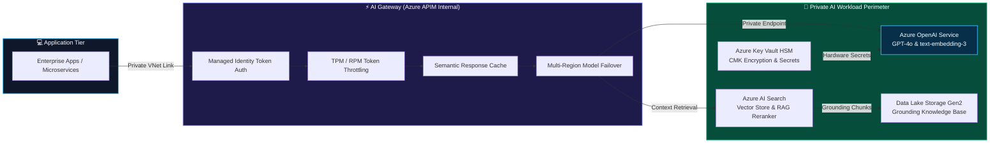

<div align="center">

<!-- Modern Hero Banner (Clear Sky Aesthetic · Sanjeev Singh) -->
<a href="https://sanjeevsingh.oneps.in" target="_blank">
  
</a>

<br><br>

<!-- Minimalist Contact Bar (Clutter-Free, Single Row) -->
<p align="center">
  <a href="https://linkedin.com/in/sanjiivsingh" target="_blank">
    
  </a>
  &nbsp;
  <a href="https://github.com/sanjiivsingh" target="_blank">
    
  </a>
  &nbsp;
  <a href="https://sanjeevsingh.oneps.in" target="_blank">
    
  </a>
  &nbsp;
  <a href="mailto:sanjeevsinghred@gmail.com">
    
  </a>
</p>

<!-- Clean Domain Highlights -->
<p align="center">
  <b>Enterprise Azure &amp; AI Landing Zones</b> • <b>Production Terraform IaC</b> • <b>Shift-Left DevSecOps</b> • <b>Banking Risk Governance (SBI)</b>
</p>

</div>

---

## 🏛️ Executive Summary

I am a **Senior Cloud & DevSecOps Platform Engineer** and **Cloud Infrastructure Consultant** with **10+ years of professional engineering and institutional governance experience**, including **5+ years architecting Microsoft Azure platforms, modular Terraform IaC, containerized Kubernetes (AKS) workloads, and automated DevSecOps pipelines**.

### 💼 What I Bring to the Table:
* **🤖 Enterprise AI & GenAI Landing Zones:** Architecting secure, Zero-Trust Azure AI foundations for Generative AI workloads—integrating **Azure OpenAI (GPT-4o & text-embedding-3)** via 100% private endpoints, API Management as an **AI Gateway** (token rate limiting, semantic caching, multi-region failover), and **Azure AI Search** for vector RAG grounding.
* **⚡ High-Concurrency Systems at Scale:** Automated and operated Azure infrastructure for a US-based futures proprietary trading platform supporting high concurrent user volume. Achieved zero-drift modular IaC, automated multi-stage rollouts, and sub-minute disaster recovery.
* **🛡️ Shift-Left DevSecOps Guardrails:** Enforcing automated security gates (**Checkov**, **tfsec**, **TFLint**, **Trivy**, and **Gitleaks**) directly inside GitHub Actions and Azure DevOps to eliminate vulnerabilities before code merge.
* **🏦 Institutional Risk & Banking Governance Foundation:** 4+ years as **Assistant Manager – Banking Operations / Risk & Compliance at State Bank of India (SBI)**, translating regulatory controls, least-privilege RBAC, and audit readiness directly into cloud infrastructure design.

---

## 🤖 Enterprise AI & GenAI Landing Zone Architecture

In the era of Generative AI, enterprise adoption requires stringent **Zero-Trust network perimeters**, **token quota governance**, and **data protection**. Below is the architectural blueprint of my production framework:

<p align="center">
  <a href="https://github.com/sanjiivsingh/azure-enterprise-ai-landing-zone-terraform" target="_blank">
    
  </a>
</p>



### 🎯 Key Architectural Deliverables:
* **Zero Public Network Exposure:** `public_network_access_enabled = false` across all AI resources; connectivity mediated exclusively via Private Endpoints on isolated subnets (`10.100.1.0/24`).
* **AI Gateway Optimization:** Inbound APIM policies enforcing token-based throttling per consumer subscription and semantic caching to reduce recurring inference costs by up to 40%.
* **Enterprise RAG Grounding:** Azure AI Search vector database indexing enterprise documentation from Azure Data Lake Gen2 with automated lifecycle governance.

👉 **[Explore Full AI Landing Zone Repository →](https://github.com/sanjiivsingh/azure-enterprise-ai-landing-zone-terraform)**

---

## 🛡️ DevSecOps Pipeline & Continuous Delivery

Security is integrated into every stage of the engineering lifecycle—**never retrofitted**. Below is the live architecture of my end-to-end delivery framework implemented across production pipelines:

<p align="center">
  
</p>

### 🔍 Automated Quality Gates & Shift-Left Controls:
1. **SCM & Passwordless Auth:** GitHub Actions / Azure DevOps with OIDC (OpenID Connect) federated credentials, eliminating long-lived secrets.
2. **Pre-Flight Validation:** Automated execution of `terraform fmt -check`, `tflint --recursive`, and `gitleaks detect` prevents misconfigurations and hardcoded credentials.
3. **Shift-Left IaC Security (SAST):** Scans Terraform manifests with **Checkov** and **tfsec** against CIS Azure Benchmarks, validating NSG rules, storage encryption, private endpoints, and RBAC least-privilege configurations.
4. **State Management & Locking:** Multi-environment state stored in Azure Blob Storage with automated lease locking, blob versioning, and TLS 1.2+ encryption.
5. **Container Hardening:** Docker images built with minimal distroless/alpine base images, scanned with **Trivy** for CVE vulnerabilities before push to ACR.
6. **Controlled Delivery:** Production environments guarded by manual approvals and automated health probes before applying changes to Azure Kubernetes Service (AKS).

👉 **[Explore DevSecOps Pipeline Repository →](https://github.com/sanjiivsingh/azure-aks-devsecops-pipeline)**

---

## 🌟 Featured Engineering Projects & Landing Zones

Direct access to production-ready architectures, modular IaC libraries, and automated frameworks:

<table>
<tr>
<td width="50%" valign="top">

### 🤖 [Azure Enterprise AI Landing Zone](https://github.com/sanjiivsingh/azure-enterprise-ai-landing-zone-terraform)
**Production Generative AI & LLM Infrastructure with Terraform**
- Complete Zero-Trust architecture for **Azure OpenAI (GPT-4o & Embeddings)** with 100% private endpoints.
- Integrated **Azure API Management (APIM)** as an AI Gateway with token-based rate limiting (TPM/RPM), semantic caching, and multi-region circuit breaking.
- Configured **Azure AI Search** vector database for enterprise RAG grounding over Data Lake Storage Gen2.
- Fully automated DevSecOps CI/CD with TFLint, Checkov SAST, tfsec, and Gitleaks.

```text
Stack: Azure OpenAI · APIM AI Gateway · AI Search Vector RAG · Key Vault · Terraform · OIDC
```
👉 **[View AI Landing Zone Repository →](https://github.com/sanjiivsingh/azure-enterprise-ai-landing-zone-terraform)**

</td>
<td width="50%" valign="top">

### 🏛️ [Azure Enterprise Hub-and-Spoke Landing Zone](https://github.com/sanjiivsingh/azure-enterprise-landing-zone-terraform)
**Enterprise Cloud Adoption Framework (CAF) Network Mesh**
- Modular Terraform provisioning a central transit Hub with **Azure Firewall**, **Azure Bastion**, and hybrid VPN/ExpressRoute gateway.
- Automated bidirectional VNet peering connecting spoke workload networks with custom **User-Defined Routes (UDRs)** forcing default `0.0.0.0/0` traffic inspection.
- Enforces subscription governance, hierarchical Management Groups, and CIS Azure benchmark policies.

```text
Stack: Hub-and-Spoke · Azure Firewall · UDR Routing · Bastion · VNet Peering · Terraform
```
👉 **[View Hub-and-Spoke Landing Zone →](https://github.com/sanjiivsingh/azure-enterprise-landing-zone-terraform)**

</td>
</tr>

<tr>
<td width="50%" valign="top">

### 🛡️ [Azure AKS DevSecOps Pipeline](https://github.com/sanjiivsingh/azure-aks-devsecops-pipeline)
**Production CI/CD: Terraform · SonarQube · Trivy · Docker · ACR · AKS**
- End-to-end continuous integration and delivery pipeline with automated Pytest unit testing and quality gates.
- Embedded static application security analysis (**Checkov** & **tfsec**) alongside **Trivy** container image vulnerability scanning for zero-day protection.
- Automated Docker container builds with non-root security context and image publishing to **Azure Container Registry (ACR)**.
- Continuous delivery to **Azure Kubernetes Service (AKS)** with rolling updates, HPA auto-scaling, and Zero-Trust NetworkPolicies.

```text
Stack: Azure AKS · Docker · ACR · Trivy · Checkov · SonarQube · Terraform · GitHub Actions
```
👉 **[View DevSecOps Pipeline Repo →](https://github.com/sanjiivsingh/azure-aks-devsecops-pipeline)**

</td>
<td width="50%" valign="top">

### 📦 [Terraform Azure Generic Resource Modules](https://github.com/sanjiivsingh/azure-resources-generic-modules-terraform)
**Reusable Multi-Tier Azure IaC Child-Modules Library**
- Engineered an enterprise library of 11+ independent, production-ready child modules: Resource Group, VNet, Subnet, NSG, Public IP, NIC, Linux VM, Bastion, Key Vault, and Application Gateway.
- Architected for multi-environment decoupling (`environments/dev`), zero hardcoded attributes, dynamic blocks for conditional resources, and implicit dependency management.
- Integrated automated GitHub Actions workflow validating formatting, syntax, and plan generation.

```text
Stack: Terraform 1.9+ · AzureRM · Modular IaC · Key Vault · App Gateway · CI/CD
```
👉 **[View Modular Library Repo →](https://github.com/sanjiivsingh/azure-resources-generic-modules-terraform)**

</td>
</tr>

<tr>
<td width="50%" valign="top">

### ⚡ [PropEdge Trading Platform Lab](https://github.com/sanjiivsingh/propedge-docker-lab)
**High-Concurrency Containerized Trading System Deployment**
- Implemented deployment and infrastructure for a containerized multi-tier proprietary trading platform.
- Multi-container stack with **Docker Compose**, segregated bridge networks between **React** frontend, **FastAPI** backend, and **PostgreSQL** database.
- Provisioned hardened **Azure Virtual Machines** with private network connectivity and strict SSH access controls.

```text
Stack: Azure VMs · Docker Compose · FastAPI · PostgreSQL · React · Cloudflare Tunnel
```
👉 **[View PropEdge Trading Lab →](https://github.com/sanjiivsingh/propedge-docker-lab)**

</td>
<td width="50%" valign="top">

### 🛠️ [CREP — Code Repository Provisioner](https://github.com/sanjiivsingh/CREP)
**CLI Tool for Standardized Git & GitHub Lifecycle Automation**
- Developed a modular Bash command-line utility to streamline project bootstrapping and standardized GitHub repository initialization.
- Automated repository creation, visibility toggling (public/private), `.gitignore` and `README` templating, and remote Git synchronization via the **GitHub CLI (`gh`)**.

```text
Stack: Bash · GitHub CLI · Git · Linux Shell · Automation
```
👉 **[View CREP Provisioner Repo →](https://github.com/sanjiivsingh/CREP)**

</td>
</tr>
</table>

---

## 🎬 Platform Architecture Reel & Interactive Overview

<div align="center">

<p align="center">
  <a href="https://sanjeevsingh.oneps.in" target="_blank">
    
  </a>
</p>

<p align="center">
  <a href="https://sanjeevsingh.oneps.in" target="_blank">
    
  </a>
  &nbsp;
  <a href="./assets/intro.mp4" target="_blank">
    
  </a>
  &nbsp;
  <a href="https://github.com/sanjiivsingh" target="_blank">
    
  </a>
</p>

</div>

---

## 🏛️ Engineering Pillars & Production Capabilities

A concise breakdown of the operational principles and standards implemented across client environments:

| Pillar | Focus Areas & Production Standards |
| :--- | :--- |
| **🤖 AI & GenAI Infrastructure** | Azure OpenAI (GPT-4o/Embeddings) · APIM AI Gateway (TPM/RPM throttling, semantic caching) · Azure AI Search vector RAG · 100% Private Endpoints · Zero public egress · NIST AI RMF compliance |
| **☁️ Azure Platform & CAF** | Multi-subscription Management Groups · Hub-and-Spoke topology · Azure Firewall & Bastion · User-Defined Routes (UDR) · Azure Policy guardrails · Private DNS zones |
| **🏗️ Terraform Infrastructure as Code** | Reusable child/root modules · Azure Blob remote state lease locking · Dynamic blocks & validation · Multi-environment promotion (Dev/UAT/Prod) · Zero-drift enforcement |
| **🛡️ DevSecOps & Shift-Left Security** | Passwordless OIDC authentication · Checkov & tfsec SAST · Trivy container vulnerability scanning · Gitleaks secret detection · Azure Key Vault HSM & CMK · CIS Azure baselines |
| **☸️ Kubernetes (AKS) & Containers** | Production AKS clusters · Workload Identity Federation · NetworkSecurityPolicies · Ingress NGINX · Horizontal Pod Autoscaler (HPA) · Minimal distroless container builds |
| **📊 Observability & FinOps** | Azure Monitor & Log Analytics · Custom KQL workbooks · Application Insights · Metric alerting & Action Groups · Cost Management right-sizing & budget alarms |

---

## 🧰 Core Technical Stack

<div align="center">

<!-- Skill Icons Animated Banner -->
<a href="https://skillicons.dev">
  
</a>

<br><br>

| Category | Technologies &amp; Tools |
| :--- | :--- |
| **🤖 AI &amp; GenAI Infrastructure** | `Azure OpenAI Service (GPT-4o, text-embedding-3)` · `Azure APIM (AI Gateway)` · `Token Rate Limiting (TPM/RPM)` · `Semantic Response Caching` · `Azure AI Search (Vector RAG)` · `Cognitive Services` · `MLOps / LLMOps` · `NIST AI RMF` |
| **☁️ Cloud Infrastructure** | `Microsoft Azure` · `Virtual Networks (VNets)` · `Subnets` · `NSGs` · `Application Gateway (WAF v2)` · `Load Balancer` · `Azure Bastion` · `NAT Gateway` · `Azure Storage (Blob & Data Lake Gen2)` · `Azure SQL` · `PostgreSQL` · `Private Endpoints` · `Private DNS` |
| **🏗️ Infrastructure as Code** | `Terraform (1.9+)` · `Reusable Child Modules` · `Remote State & Lease Locking (Azure Blob)` · `Dynamic Blocks` · `Locals` · `Input Validation` · `Multi-Environment Architectures (Dev/UAT/Prod)` |
| **🛡️ DevSecOps &amp; Security** | `Azure RBAC` · `Least-Privilege Access` · `Azure Key Vault HSM` · `Checkov` · `tfsec` · `TFLint` · `Trivy (Container Scanning)` · `Gitleaks` · `TruffleHog` · `SonarQube` · `Zero Trust` · `IaC Security Baselines (CIS Azure)` |
| **🚀 CI/CD &amp; Automation** | `GitHub Actions` · `Azure DevOps Pipelines` · `Passwordless Azure OIDC Federation` · `Automated Plan/Apply` · `Quality Gates` · `Deployment Approval Workflows` · `Git` · `GitHub CLI` |
| **☸️ Containers &amp; Orchestration** | `Docker` · `Docker Compose` · `Azure Kubernetes Service (AKS)` · `Azure Container Registry (ACR)` · `Helm` · `Multi-Stage Container Builds` · `K8s NetworkPolicies` |
| **⚙️ Scripting &amp; Tooling** | `Linux Administration` · `Bash Shell Scripting` · `Python` · `YAML` · `PowerShell` |
| **📊 Observability &amp; FinOps** | `Azure Monitor` · `Log Analytics Workspaces` · `Application Insights` · `KQL Kusto Query Language` · `Alerts & Action Groups` · `Cloud Cost Governance & FinOps Right-Sizing` |

</div>

---

## 💼 Professional Experience & Banking Governance Heritage

```text
├── FREELANCE / CONTRACT CLOUD & DEVSECOPS ENGINEER (2021 – Present)
│   ├── Multiple Enterprise Client Engagements | Gurugram, India
│   └── US-Based Futures Proprietary Trading Platform
│       ├── Supported Azure infrastructure automation & DevOps for a high-volume trading platform
│       ├── Engineered modular Terraform modules for networking, compute, storage, Key Vault, and AKS
│       ├── Implemented DevSecOps pipelines with Checkov, tfsec, TFLint, Trivy, and Gitleaks
│       └── Centralized Terraform remote state backend in Azure Storage with automated locking
│
└── STATE BANK OF INDIA (2012 – 2016)
    └── Assistant Manager – Banking Operations / Risk & Compliance
        ├── Managed banking operations involving operational risk controls, audit & regulatory compliance
        ├── Supervised access-control and authorization processes for high-value financial transactions
        └── Formed the risk-management and zero-trust mindset applied directly to Cloud Security today
```

---

## 🏆 Certifications & Professional Recognition

<div align="center">

| Award / Certification | Issuing Organization | Year |
| :--- | :--- | :---: |
| 🎓 **Google AI Essentials** | Google | **2025** |
| 🛡️ **DevSecOps Initiative Award** | Engineering Recognition | **2023** |
| 🎖️ **Spotlight Award (Operational Excellence)** | State Bank of India (SBI) | **2015** |
| 📜 **JAIIB** | Indian Institute of Banking & Finance | **2014** |
| 🎓 **Bachelor of Computer Applications (BCA)** | Indira Gandhi National Open University (IGNOU) | **2009** |

</div>

---

## 📈 Engineering Velocity & Analytics

<div align="center">

### 🐍 GitHub Contribution Snake Animation

<picture>
  <source media="(prefers-color-scheme: dark)" srcset="https://raw.githubusercontent.com/sanjiivsingh/sanjiivsingh/output/github-contribution-grid-snake-dark.svg">
  <source media="(prefers-color-scheme: light)" srcset="https://raw.githubusercontent.com/sanjiivsingh/sanjiivsingh/output/github-contribution-grid-snake.svg">
  
</picture>

<br><br>

<!-- Streak Stats & GitHub Profile Stats Side-by-Side -->
<p align="center">
  <a href="https://github.com/sanjiivsingh">
    
  </a>
  <a href="https://github.com/sanjiivsingh">
    
  </a>
</p>

<!-- Top Languages Bar -->
<p align="center">
  <a href="https://github.com/sanjiivsingh">
    
  </a>
</p>

</div>

---

## 🤝 Let's Collaborate

Whether you are designing **Enterprise Azure & AI Landing Zones**, adopting **Terraform Infrastructure as Code**, hardening **Kubernetes (AKS)** clusters, or establishing **automated DevSecOps guardrails**, I am available for high-impact consulting and client engagements.

<div align="center">

<p align="center">
  <a href="mailto:sanjeevsinghred@gmail.com">
    
  </a>
</p>

<br>

<p align="center">
  <a href="mailto:sanjeevsinghred@gmail.com">
    
  </a>
  &nbsp;
  <a href="https://linkedin.com/in/sanjiivsingh" target="_blank">
    
  </a>
  &nbsp;
  <a href="https://github.com/sanjiivsingh" target="_blank">
    
  </a>
  &nbsp;
  <a href="https://sanjeevsingh.oneps.in" target="_blank">
    
  </a>
</p>

<br>


</div>
