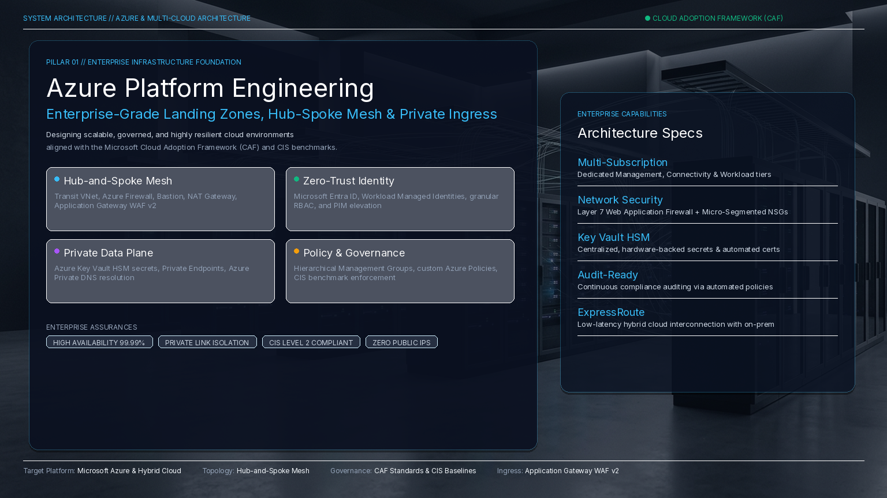
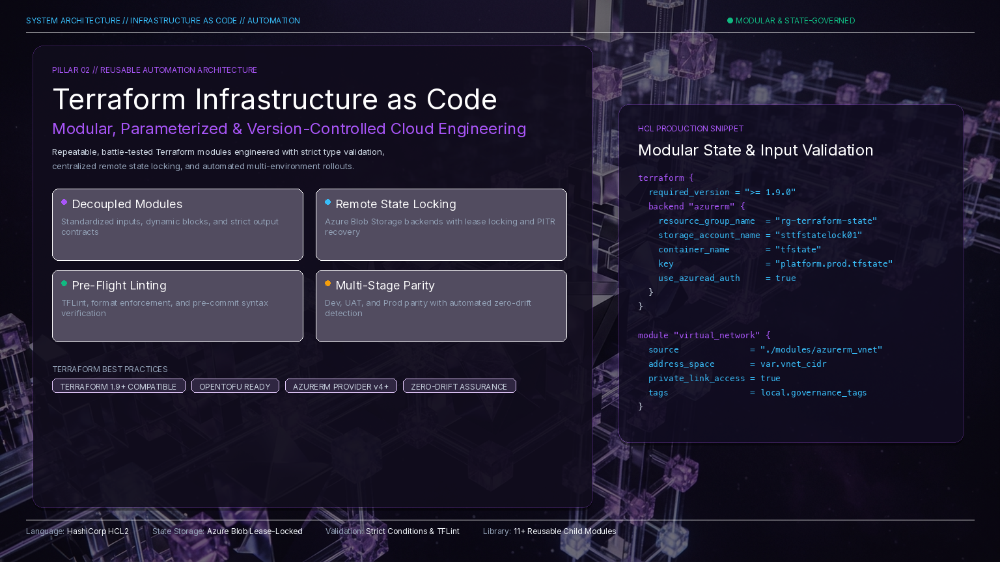
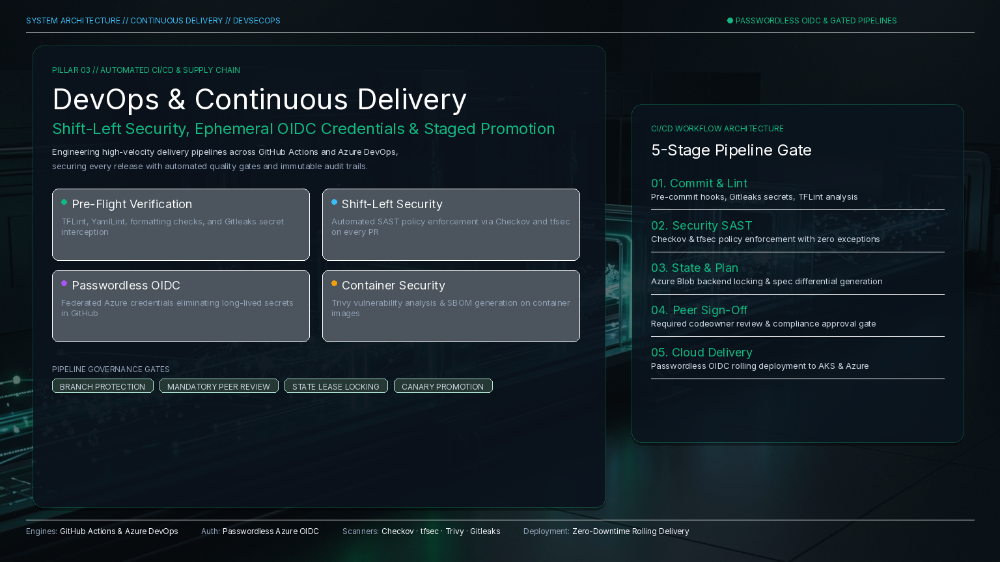
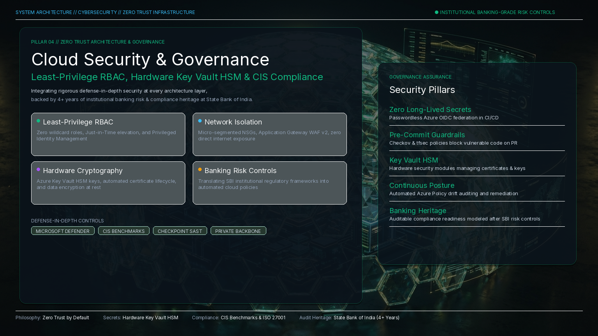
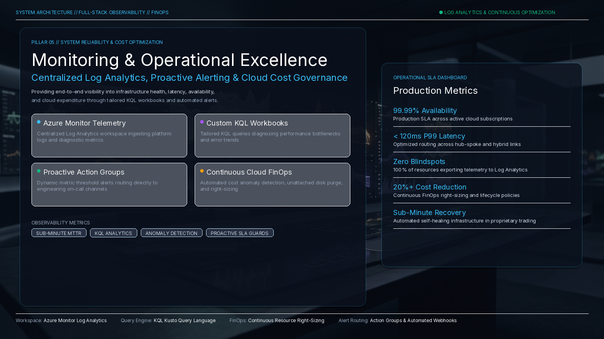
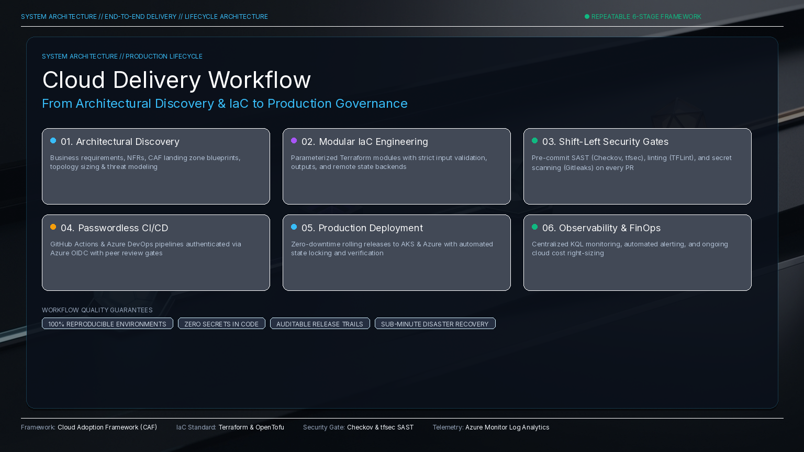
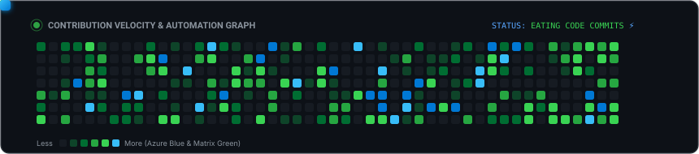

<div align="center">

<!-- Hero Banner -->


<br><br>

<!-- Animated Dynamic Typing Banner -->
<a href="https://linkedin.com/in/sanjiivsingh">
  
</a>

<br>

<!-- Profile Connect & Badges -->
<p align="center">
  <a href="https://linkedin.com/in/sanjiivsingh" target="_blank">
    
  </a>
  <a href="https://github.com/sanjiivsingh" target="_blank">
    
  </a>
  <a href="https://sanjeevsingh.oneps.in" target="_blank">
    
  </a>
  <a href="mailto:theinvinciblesanjeev@gmail.com">
    
  </a>
  <a href="https://twitter.com/sanjiiv_singh" target="_blank">
    
  </a>
</p>

<!-- Competency Pill Badges -->
<p align="center">
  
  
  
  
  
  
  
  
</p>

<!-- Fast Navigation Menu -->
<p align="center">
  <a href="#-executive-summary"><b>Executive Summary</b></a> •
  <a href="#-devsecops-pipeline--continuous-delivery-architecture"><b>DevSecOps Pipeline</b></a> •
  <a href="#-featured-engineering-projects"><b>Featured Projects</b></a> •
  <a href="#-core-technical-stack--skills-matrix"><b>Skills Matrix</b></a> •
  <a href="#-professional-experience--banking-governance-foundation"><b>Experience &amp; Governance</b></a> •
  <a href="#-engineering-velocity--analytics"><b>Analytics &amp; Snake</b></a> •
  <a href="#-lets-collaborate"><b>Contact</b></a>
</p>

</div>

---

# 🚀 Executive Summary

I am a **Cloud & DevSecOps Engineer** with **10+ years of professional experience across IT, cloud infrastructure, and banking operations**, including **5+ years specializing in Microsoft Azure, Terraform, CI/CD, and infrastructure automation**. 

My core focus is designing, automating, and maintaining **secure-by-default, scalable, and audit-ready cloud platforms** that accelerate software delivery while eliminating manual toil and configuration drift.

### 💼 What Sets Me Apart:
- **High-Concurrency Production Experience:** Provided Azure infrastructure automation and DevOps support for a high-volume **US-based futures proprietary trading platform** serving thousands of concurrent users, handling Terraform modularization, zero-downtime CI/CD, and cloud operations.
- **Enterprise DevSecOps Guardrails:** Shift-left security practitioner embedding automated quality gates (**TFLint**, **Checkov**, **tfsec**, **Trivy**, **Gitleaks**, and **SonarQube**) directly into GitHub Actions and Azure DevOps pipelines.
- **Banking Governance & Risk Compliance Heritage:** 4+ years as **Assistant Manager – Banking Operations / Risk & Compliance at State Bank of India (SBI)**. This unique foundation provides deep, practical expertise in **operational risk controls**, **least-privilege RBAC**, **procedural compliance**, and **access governance**—ensuring mission-critical infrastructure satisfies strict regulatory standards.

### 🎯 Business Value Delivered

| Solution Domain | Architectural Deliverable | Measurable Business Impact |
| :--- | :--- | :--- |
| **☁️ Azure Landing Zones** | Hub-and-spoke networks, subscription governance, Azure Policies, Entra ID | Standardized, enterprise-ready foundations built in hours rather than months |
| **🏗️ Modular Terraform IaC** | Versioned modules, Azure Blob state locking, dynamic blocks & validation | 100% reproducible environments across Dev, UAT, and Production with zero drift |
| **🛡️ DevSecOps & Shift-Left** | Automated SAST (Checkov/tfsec), secret detection (Gitleaks), Trivy container audit | Security vulnerabilities flagged and blocked *before* pull requests merge |
| **🚀 Automated CI/CD** | GitHub Actions & Azure DevOps pipelines with OIDC passwordless authentication | Safe, repeatable, automated releases with branch protection and manual approvals |
| **☸️ Container Platforms** | AKS clusters, ACR registries, Docker Compose networking & microservices | Resilient, containerized microservice architectures with private networking |
| **📊 Operational Excellence** | Azure Monitor, Log Analytics workspaces, diagnostic settings, automated alerts | Real-time visibility, proactive incident reduction, and cloud cost optimization |

---

# 🛡️ DevSecOps Pipeline & Continuous Delivery Architecture

Security is integrated into every stage of the engineering lifecycle—**never retrofitted**. Below is the live architecture of my end-to-end delivery framework implemented across production pipelines:

### ⚡ Live Workflow Architecture

<p align="center">
  
</p>


<details>
<summary><b>🔍 Expand Pipeline Technical Specifications &amp; Quality Gates</b></summary>

<br>

1. **SCM & Authentication:** GitHub / Azure DevOps with OIDC (OpenID Connect) federated credentials, eliminating long-lived secrets or static passwords. Branch protection rules require signed commits, peer reviews, and mandatory status checks.
2. **Pre-Flight Validation:** Automated execution of `terraform fmt -check`, `tflint --recursive`, and `gitleaks detect` prevents misconfigurations and hardcoded credentials before code review.
3. **Shift-Left IaC Security (SAST):** Scans Terraform manifests with **Checkov** and **tfsec** against CIS Azure Benchmarks, validating NSG ingress rules, storage encryption, private endpoints, and RBAC least-privilege configurations.
4. **State Management & Locking:** Multi-environment state stored in Azure Blob Storage with automated lease locking, blob versioning, and TLS 1.2+ encryption, eliminating state concurrency conflicts.
5. **Container Hardening:** Docker images built with minimal distroless/alpine base images, scanned with **Trivy** for CVE vulnerabilities, and signed before push to Azure Container Registry (ACR).
6. **Controlled Continuous Delivery:** Production environments guarded by GitHub Environment Protection rules requiring manual approvals and automated health probes before applying changes to Azure Kubernetes Service (AKS).

</details>

---

# 🌟 Featured Engineering Projects

Direct links to open-source architectures, automation frameworks, and hands-on production labs:

<table>
<tr>
<td width="50%" valign="top">

### 🏛️ [Terraform Azure Foundation](https://github.com/sanjiivsingh/terraform-azure-foundation)
**Enterprise Multi-Tier Infrastructure as Code Architecture**
- Designed a modular, multi-tier Terraform repository provisioning standardized Azure infrastructure components with environment-specific variable hierarchies (`dev`, `prod`).
- Reusable modules for Virtual Networks, Subnets, Key Vault with zero-trust ACLs, and Storage Accounts.
- Built GitHub Actions automation executing code formatting, syntax validation, security analysis (**Checkov**), and linting (**TFLint**) prior to pull request merges.
- Integrated centralized remote state storage with automated state locking using **Azure Blob Storage**.

```text
Stack: Terraform · Azure VNets · Key Vault · Checkov · TFLint · GitHub Actions
```
👉 **[View Repository →](https://github.com/sanjiivsingh/terraform-azure-foundation)**

</td>
<td width="50%" valign="top">

### 🛡️ [Azure AKS DevSecOps Pipeline](https://github.com/sanjiivsingh/azure-aks-devsecops-pipeline)
**Production CI/CD: Terraform · Trivy · Docker · ACR · Kubernetes (AKS)**
- Built an end-to-end continuous integration and delivery pipeline with automated Pytest unit testing, linting, and quality gates.
- Embedded static application security analysis (**Checkov** & **tfsec**) alongside **Trivy** container image vulnerability scanning for zero-day protection.
- Automated Docker container builds with non-root security context and image publishing to **Azure Container Registry (ACR)**.
- Continuous delivery to **Azure Kubernetes Service (AKS)** with rolling updates, HPA auto-scaling, and Zero-Trust NetworkPolicies.

```text
Stack: Azure AKS · Docker · ACR · Trivy · Checkov · Terraform · GitHub Actions
```
👉 **[View Repository →](https://github.com/sanjiivsingh/azure-aks-devsecops-pipeline)**

</td>
</tr>

<tr>
<td width="50%" valign="top">

### ⚡ [PropEdge Trading Platform Lab](https://github.com/sanjiivsingh/PropEdge-Docker-Lab)
**High-Concurrency Containerized Trading System Deployment**
- Implemented deployment and infrastructure for a containerized multi-tier proprietary trading platform.
- Configured a multi-container stack with **Docker Compose**, utilizing segregated bridge networks between the **React** frontend, **FastAPI** backend, and **PostgreSQL** database.
- Provisioned hardened **Azure Virtual Machines** with private network connectivity and strict SSH access controls.
- Integrated **Cloudflare Tunnel** for secure administrative access, avoiding publicly exposed ingress ports during testing and validation.

```text
Stack: Azure VMs · Docker Compose · FastAPI · PostgreSQL · React · Cloudflare
```
👉 **[View Repository →](https://github.com/sanjiivsingh/PropEdge-Docker-Lab)**

</td>
<td width="50%" valign="top">

### 🛠️ [CREP — Code Repository Provisioner](https://github.com/sanjiivsingh/CREP)
**CLI Tool for Standardized Git & GitHub Lifecycle Automation**
- Developed a modular Bash command-line utility to streamline project bootstrapping and standardized GitHub repository initialization.
- Automated repository creation, visibility toggling (public/private), `.gitignore` and `README` templating, and remote Git synchronization via the **GitHub CLI (`gh`)**.
- Enforced organizational naming conventions and default branch protection rules from day one.

```text
Stack: Bash · GitHub CLI · Git · Linux Shell · Automation
```
👉 **[View Repository →](https://github.com/sanjiivsingh/CREP)**

</td>
</tr>

<tr>
<td width="50%" valign="top">

### 🔄 [End-to-End Terraform CI/CD](https://github.com/sanjiivsingh/workflow-basic-1)
**Automated Plan, Lint & Apply Pipeline with Azure OIDC**
- Complete automated delivery workflow executing automated Terraform linting (`tflint`), formatting, and static security analysis on pull requests.
- Generates and uploads spec plans for reviewer inspection, followed by automated zero-drift `terraform apply` upon PR merge.
- Authenticates securely to Azure subscriptions utilizing passwordless **GitHub Actions OIDC Federation**.

```text
Stack: GitHub Actions · Terraform · Azure OIDC · Checkov · TFLint
```
👉 **[View Repository →](https://github.com/sanjiivsingh/workflow-basic-1)**

</td>
<td width="50%" valign="top">

### 🌐 [Azure Modular VM & Network Lab](https://github.com/sanjiivsingh/azure-terraform-modular-vm-lab)
**Hub-and-Spoke Topology with VNet Peering & Security**
- Modular Terraform configuration deploying enterprise networking topologies with VNets, subnets, Network Security Groups, and bidirectional peering.
- Implemented Azure Bastion hosts for secure management and private IP interconnectivity across multi-tier workloads.

```text
Stack: Terraform · Azure VNets · NSG · VNet Peering · Bastion
```
👉 **[View Repository →](https://github.com/sanjiivsingh/azure-terraform-modular-vm-lab)**

</td>
</tr>
</table>

---

# ☁️ Azure Platform Engineering

Enterprise-ready Azure environments built around Cloud Adoption Framework (CAF) Landing Zones, governance, networking, identity, security, monitoring, and operational excellence.

<p align="center">
  
</p>

- **Enterprise Landing Zones:** Subscription organization, Management Groups, and custom Azure Policy enforcement.
- **Hub-and-Spoke Networking:** Virtual Networks (VNets), subnets, Application Gateways, NAT Gateways, Azure Bastion, and Private Link.
- **Identity & Access Management:** Microsoft Entra ID integration, Managed Identities, and granular RBAC.
- **Data Protection:** Azure Key Vault for hardware-backed secrets and certificate lifecycle automation.

---

# 🏗️ Terraform Infrastructure as Code

Repeatable, version-controlled cloud infrastructure engineered using modular hierarchies and automated state management.

<p align="center">
  
</p>

- **Modular Architecture:** Reusable child and root modules with standardized variable hierarchies and outputs.
- **State Integrity:** Centralized Azure Blob Storage backends with automated lease locking and point-in-time recovery.
- **Dynamic Blocks & Input Validation:** Built-in condition checks and validation rules ensuring misconfigurations are prevented before plan generation.

---

# 🚀 DevOps & Continuous Delivery

Automating software delivery with GitHub Actions and Azure DevOps to enable frequent, safe, and auditable releases.

<p align="center">
  
</p>

- **Passwordless OIDC Federation:** Zero long-lived credentials stored in repository secrets.
- **Approval Workflows:** Production environments locked behind multi-stage peer reviews and compliance sign-offs.
- **Release Automation:** Automated changelog generation, release tagging, and artifact publishing.

---

# 🔒 Cloud Security & Governance

Zero Trust security architecture protecting mission-critical workloads at every tier.

<p align="center">
  
</p>

- **Least-Privilege RBAC:** Fine-grained role assignments eliminating wildcard access across cloud subscriptions.
- **Network Segmentation:** Strict Network Security Group (NSG) rules and Private Endpoints keeping database and backend tiers off the public internet.
- **Audit & Governance:** Automated compliance audits using Checkov and tfsec mapped against CIS Azure baselines.

---

# 📊 Monitoring & Operational Excellence

Continuous observability providing actionable insights into infrastructure health, latency, availability, and cloud expenditure.

<p align="center">
  
</p>

- **Azure Monitor & Log Analytics:** Centralized KQL queries, custom workbooks, and resource diagnostic settings.
- **Proactive Alerting:** Metric alerts, Action Groups, and automated notifications for swift incident response.
- **Cost Optimization:** Right-sizing compute resources, storage tier lifecycles, and Azure Cost Management reporting.

---

# 🔄 Cloud Delivery Workflow

From business requirements through production operations:

<p align="center">
  
</p>

---

# 🧰 Core Technical Stack & Skills Matrix

<div align="center">

<!-- Skill Icons Animated Banner -->
<a href="https://skillicons.dev">
  
</a>

<br><br>

</div>

| Category | Technologies &amp; Tools |
| :--- | :--- |
| **☁️ Cloud Infrastructure** | `Microsoft Azure` · `VNets` · `Subnets` · `NSGs` · `Application Gateway` · `Load Balancer` · `Azure Bastion` · `NAT Gateway` · `Azure Storage` · `Azure SQL` · `PostgreSQL` · `Private Endpoints` · `Private DNS` |
| **🏗️ Infrastructure as Code** | `Terraform` · `Reusable Modules` · `Remote State & Locking (Azure Blob)` · `Dynamic Blocks` · `Locals` · `Input Validation` · `Multi-Environment Architectures` |
| **🛡️ DevSecOps &amp; Security** | `Azure RBAC` · `Azure Key Vault` · `Checkov` · `tfsec` · `TFLint` · `Trivy (Container Scan)` · `Gitleaks` · `TruffleHog` · `SonarQube` · `Zero Trust` · `IaC Security Baselines` |
| **🚀 CI/CD &amp; Automation** | `GitHub Actions` · `Azure DevOps Pipelines` · `OIDC Authentication` · `Automated Plan/Apply` · `Quality Gates` · `Deployment Approvals` · `Git` · `GitHub CLI` |
| **☸️ Containers &amp; Orchestration** | `Docker` · `Docker Compose` · `Azure Kubernetes Service (AKS)` · `Azure Container Registry (ACR)` · `Helm` · `Multi-stage Builds` |
| **⚙️ Scripting &amp; Systems** | `Linux Administration` · `Bash Shell Scripting` · `Python` · `YAML` · `PowerShell` |
| **📊 Observability &amp; Operations** | `Azure Monitor` · `Log Analytics Workspaces` · `Application Insights` · `Alerts & Action Groups` · `Cost Optimization` |

---

# 💼 Professional Experience & Banking Governance Foundation

```text
├── FREELANCE / CONTRACT CLOUD & DEVSECOPS ENGINEER (2021 – Present)
│   ├── Multiple Enterprise Client Engagements | Gurugram, India
│   └── US-Based Futures Proprietary Trading Platform
│       ├── Supported Azure infrastructure automation & DevOps for high-volume trading platform
│       ├── Engineered modular Terraform modules for networking, compute, storage, Key Vault, and AKS
│       ├── Implemented DevSecOps pipelines with Checkov, tfsec, TFLint, Trivy, and Gitleaks
│       └── Centralized Terraform remote state backend in Azure Storage with automated locking
│
└── STATE BANK OF INDIA (2012 – 2016)
    └── Assistant Manager – Banking Operations / Risk & Compliance
        ├── Managed banking operations involving operational risk controls, audit & regulatory compliance
        ├── Supervised access-control and authorization processes for high-value financial transactions
        └── Formed the risk-management and zero-trust mindset applied directly to Cloud Security today
```

---

# 🏆 Certifications & Professional Recognition

<div align="center">

| Award / Certification | Issuing Organization | Year |
| :--- | :--- | :---: |
| 🎓 **Google AI Essentials** | Google | **2025** |
| 🛡️ **DevSecOps Initiative Award** | Engineering Recognition | **2023** |
| 🎖️ **Spotlight Award (Operational Excellence)** | State Bank of India (SBI) | **2015** |
| 📜 **JAIIB** | Indian Institute of Banking & Finance | **2014** |
| 🎓 **Bachelor of Computer Applications (BCA)** | Indira Gandhi National Open University (IGNOU) | **2009** |

</div>

---

# 📈 Engineering Velocity & Analytics

<div align="center">

### 🐍 GitHub Contribution Snake Animation

<picture>
  <source media="(prefers-color-scheme: dark)" srcset="https://raw.githubusercontent.com/sanjiivsingh/sanjiivsingh/output/github-contribution-grid-snake-dark.svg">
  <source media="(prefers-color-scheme: light)" srcset="https://raw.githubusercontent.com/sanjiivsingh/sanjiivsingh/output/github-contribution-grid-snake.svg">
  
</picture>

<br><br>

<!-- Streak Stats & GitHub Profile Stats Side-by-Side -->
<p align="center">
  <a href="https://github.com/sanjiivsingh">
    
  </a>
  <a href="https://github.com/sanjiivsingh">
    
  </a>
</p>

<!-- Top Languages Bar -->
<p align="center">
  <a href="https://github.com/sanjiivsingh">
    
  </a>
</p>

</div>

---

# 🤝 Let's Collaborate

Whether you are building out **Enterprise Azure Landing Zones**, adopting **Terraform Infrastructure as Code**, hardening **Kubernetes (AKS)** environments, or establishing **automated DevSecOps guardrails**, I am available for high-impact freelance consulting and long-term client engagements.

<div align="center">


<br><br>

<p align="center">
  <a href="mailto:theinvinciblesanjeev@gmail.com">
    
  </a>
  <a href="https://linkedin.com/in/sanjiivsingh" target="_blank">
    
  </a>
  <a href="https://github.com/sanjiivsingh" target="_blank">
    
  </a>
  <a href="https://sanjeevsingh.oneps.in" target="_blank">
    
  </a>
</p>

<br>


</div>
